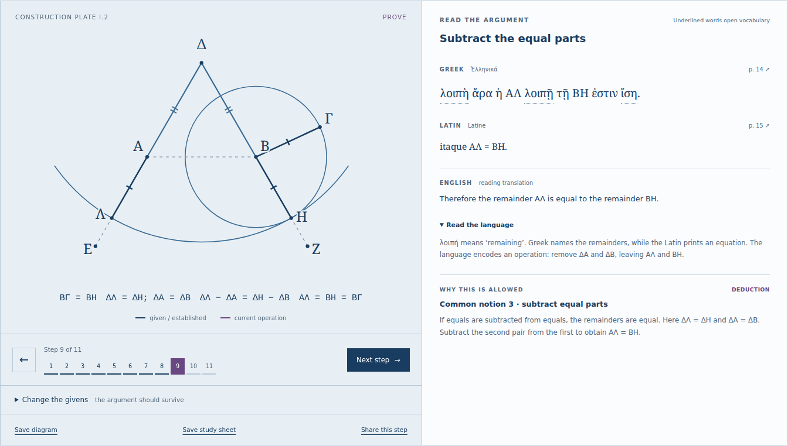
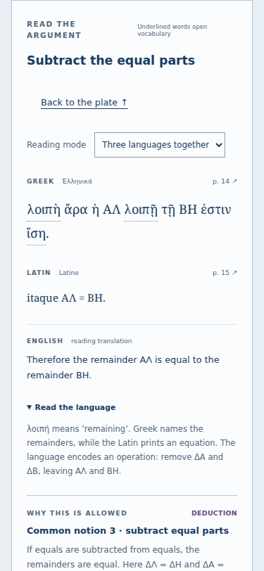

# Stoicheia

Read Euclid’s opening arguments in Greek, Latin and English, with a working diagram beside every step.

[](LICENSE)
[](https://antonsoo.github.io/stoicheia/)



A diagram can make Euclid look obvious while hiding the reason a step is allowed.
A translation can make the argument readable while hiding the Greek that carries
it. Stoicheia connects both: change the givens, follow the command on the plate,
read the two source languages, and ask what established the equality.

The opening course is **Book I, propositions 1–10**. It includes the complete
statements and proofs, divided into 85 aligned reading steps, with 36 selected
vocabulary entries, thirteen foundation statements and twenty passage-based
reading exercises. It is intended for an English-speaking reader who knows basic
geometry and is beginning Greek or Latin.

**[Open the course](https://antonsoo.github.io/stoicheia/)** ·
[Source repository](https://github.com/antonsoo/stoicheia). The app is a static
site; no package registry installation is required.

## Run it

Node.js 24 or later:

```sh
git clone https://github.com/antonsoo/stoicheia.git
cd stoicheia && npm ci
npm run dev
```

Open `http://127.0.0.1:4327/stoicheia/`. The production build is `npm run build`,
which writes a complete static site to `dist/`. `npm run preview` serves that build
on the same port; stop the development server before starting the preview.

## Read, construct, inspect

| Proposition | What you make                                             | What the lesson exposes                                                                            |
| ----------- | --------------------------------------------------------- | -------------------------------------------------------------------------------------------------- |
| I.1         | Equilateral triangle on a given segment                   | The two radius equalities, common notion 1, and the unstated intersection assumption               |
| I.2         | An equal length at a separate point                       | The equilateral triangle supplies equal parts to subtract from equal radii                         |
| I.3         | A part of the longer segment equal to the shorter         | I.2 becomes an available construction, and the greater–lesser hypothesis matters                   |
| I.4         | Triangle congruence from two sides and the included angle | Rigid superposition, corresponding vertices, and an unstated motion assumption                     |
| I.5         | Equal interior and exterior base angles                   | Two overlapping triangle comparisons, then subtraction of equal angles                             |
| I.6         | Equal sides from equal angles                             | A contradiction, with the impossible conjunction explicitly distinguished from the measured sketch |
| I.7         | Uniqueness of a meeting point on one side of a base       | The same-side restriction, a conditional equality, and the printed proof’s placement assumptions   |
| I.8         | Congruence from three side pairs                          | The angle is earned; impossible three-length inputs do not fabricate a triangle                    |
| I.9         | An internal angle bisector                                | One circle crossing works throughout; the other can work, collapse, or point outward               |
| I.10        | Equal halves of a segment                                 | Earlier constructions reuse two circles, and their intersection earns the midpoint                 |
- Move through the commands and deductions at your own pace. Every step names its
  permission: postulate, definition, common notion, earlier proposition, or
  assumption. Earlier constructions can be opened from the reason that uses them.
- Select underlined Greek or Latin words for a lemma, equivalent, transliteration
  and explanation of the forms. The reading notes explain selected syntax in
  context, including the difference between commands and completed results.
- Read Greek-first or Latin-first and reveal the other languages when ready.
  Twenty exercises ask about the wording of actual passages, explain each
  interpretation, and return you to the corresponding step.
- Open a reason’s source to compare the definition, postulate or common notion
  in all three languages. The reader distinguishes Heiberg’s numbering from the
  usual five-item common-notion list.
- Change the given lengths with keyboard-accessible sliders. Flip the triangle,
  or change the reference angle in I.2. In I.3, a reference of 100% or more fails
  the stated hypothesis and withholds the constructed cut.
- In I.4, move one triangle onto the other with a shape-preserving rotation and
  translation. In I.5, trace each of the compared triangles and follow the
  whole-angle / removed-part / remainder table. I.6 keeps its temporary
  supposition visibly separate from the original given, including in downloads.
- Move I.7’s second candidate while retaining its first distance, then reflect
  it across the base to see why the same-side hypothesis matters. In I.8, choose
  three lengths and compare the triangles by rigid motion.
- Open I.7’s [missing-case exploration](https://antonsoo.github.io/stoicheia/#p=7&case=1&turn=55&case-step=2).
  Move Δ into the first triangle, find why the printed whole-and-part reason
  stops fitting, and repair it with I.5’s exterior angles. Inspect the exact
  boundary, reflection and coincidence too. Share a placement or save its
  complete argument and the Greek/Latin clause as a standalone case study.
- Explore both circle crossings in I.9 at 40°, 60° and 90°. The alternate ray
  can bisect, vanish or lie outside the given angle. I.10 then reuses the circles
  to construct a midpoint from I.1, I.9 and I.4.
- Open the printed page for either language, zoom it and pan with the keyboard.
  All twenty-eight source pages are bundled. The full aligned passage is available below
  the plate, with links back to individual steps.
- Share the current proposition, step and parameters in a URL fragment. Save the
  current diagram as SVG or the entire lesson as a standalone HTML study sheet.
  The downloaded sheet contains the diagram, all three languages, reasons, relevant foundation statements, notes and
  attribution, and opens without scripts or network access.
- Browser printing produces the full parallel passage, even when it is collapsed
  on screen, and restores the previous reading state afterward. An actual
  [I.5 print PDF](examples/stoicheia-I5-reading.pdf) is included. Use the study-sheet
  download when you also want the diagram, reasons and notes.
- The production edition precaches its text, diagrams, font and source pages.
  Wait for “Edition ready offline” before disconnecting. Offline reloads require
  HTTPS or localhost and a browser that permits service workers. Development mode
  deliberately does not install an offline worker. Readiness is checked against
  the edition currently open; an older active worker cannot certify a newer
  course. Each precached file must also match its build-time SHA-256 before
  the worker activates. An open tab offers a reload when a different edition
  takes control.



A [downloaded I.2 study sheet](examples/stoicheia-I2-study.html) is included as a
working example, alongside [I.6’s contradiction sheet](examples/stoicheia-I6-study.html),
[I.9’s outward-ray exploration](examples/stoicheia-I9-opposite-ray.html), and
[I.10’s midpoint construction](examples/stoicheia-I10-study.html). Save a sheet and
open it directly in a browser to read without the app.

## The source is part of the lesson

The Greek and Latin are transcribed from J. L. Heiberg’s _Euclidis opera omnia_,
volume I (Leipzig: Teubner, 1883), printed pp. 4–31. Heiberg’s Latin is a
**nineteenth-century translation**, not an ancient Latin text. The English is a
new reading translation; explanations sometimes make an implied intersection
explicit. Point names remain Greek throughout.

The [University of Toronto scan](https://archive.org/details/euclidisoperaomn01eucluoft)
is public domain. The page images and download hashes are recorded in
[`public/sources/manifest.json`](public/sources/manifest.json). The
[editorial note](docs/sources.md) records normalized glyphs, omitted reference
marks, the retained editorial brackets, the clipped margin on p. 6 and how the source diagrams differ from the
working plates. Critical apparatus is visible on the scans but is not transcribed
into the reader.

Mathematical notes were cross-checked against David E. Joyce’s commentary at
Clark University: [I.1](https://mathcs.clarku.edu/~djoyce/elements/bookI/propI1.html),
[I.2](https://mathcs.clarku.edu/~djoyce/elements/bookI/propI2.html),
[I.3](https://mathcs.clarku.edu/~djoyce/elements/bookI/propI3.html),
[I.4](https://mathcs.clarku.edu/~djoyce/elements/bookI/propI4.html),
[I.5](https://mathcs.clarku.edu/~djoyce/elements/bookI/propI5.html),
[I.6](https://mathcs.clarku.edu/~djoyce/elements/bookI/propI6.html),
[I.7](https://mathcs.clarku.edu/~djoyce/elements/bookI/propI7.html),
[I.8](https://mathcs.clarku.edu/~djoyce/elements/bookI/propI8.html),
[I.9](https://mathcs.clarku.edu/~djoyce/elements/bookI/propI9.html),
[I.10](https://mathcs.clarku.edu/~djoyce/elements/bookI/propI10.html).

## How the construction works

The core is separate from the reading content and interface. I.1 computes either
circle intersection on the base segment. I.2 actually constructs its return
point; it does not simply assign the reference length to a new segment.

Using the common English label convention for the following diagram only:

```text
          D
         / \
        A---B       DA = DB       (I.1)
       /     \
      L       G     DL = DG       (circle at D)

     DL - DA = DG - DB
        AL  =  BG = BC           (equal remainders, then equal radii)
```

`transfer(a, b, c)` first constructs D, intersects the extended DB with the circle
at B through C to obtain G, then uses the circle at D through G to obtain L on
extended DA. In a calculated teaching example with AB = 180 and BC = 117, the calculation
gives DL = DG = 297, DA = DB = 180, and AL = BC = 117. I.3 calls that construction
and uses its output as the radius of the circle locating the cut.

SVG coordinates are computed from the geometry; equality marks follow established
arguments. The numerical table is explicitly a check in relative units. It is
not used as the reason an equality holds.

The app uses TypeScript and Vite, with no runtime framework or network service.
The production build generates a content-versioned service worker. Text is escaped
before markup is created; URL state accepts bounded numeric parameters only. The
font and its license are self-hosted. There is no analytics, remote font request
or stored reading history.

## Verification

```sh
npm run check
npm run verify:oracle
npm run verify:triangles
npm run verify:bisections
```

The TypeScript checks cover constructions, invalid hypotheses, complete lesson
scenes, shared-state parsing, inflected vocabulary and exports. More importantly,
an independent Python standard-library oracle uses 60-digit `Decimal` arithmetic
and general circle-circle and quadratic line-circle intersections to reproduce
the points without importing the app code.

The retained [oracle result](docs/geometry-oracle.json) has 720 input cases,
4,320 point comparisons and 5,760 equality checks. Maximum relative coordinate
error is `1.1526305883259686e-15`, below the `2e-12` tolerance. These inputs rotate,
translate and resize the constructions and exercise both triangle orientations.

A second [independent check](docs/triangle-oracle.json) uses cosine-law angles,
shoelace areas and Euclidean distances to inspect 480 I.4 motion cases, 96 I.5
constructions and 96 I.6 hypothetical sketches. All 8,064 checks passed. It verifies
both I.5 triangle correspondences and the final angle subtraction, and requires
I.6’s scalene sketch to have unequal base angles and a strictly smaller inner
triangle. These are numerical checks, not a formal proof checker.

The [bisection and uniqueness check](docs/bisection-oracle.json) independently
inspects 1,336 cases, including 112 impossible three-length inputs, both I.9
crossings and rotated I.10 constructions. Its 11,381 checks use cosine-law angles,
circle equations, ray directions and an arithmetic midpoint oracle. I.9’s I.3
length-copy result is also checked; agreement is not inferred from rounded labels.

For browser verification, serve the production build with `npm run preview`, then
run `npm run test:browser` in another terminal. Playwright needs matching Chromium
and Firefox browsers already available. On a new development machine they can be
installed with `npx playwright install --with-deps chromium firefox`.

The [browser receipt](docs/browser-verification.json) records the tested browser
versions, desktop and 375px viewports, rendered side equalities, source-page
navigation, vocabulary focus return, invalid-length handling, shared links,
standalone downloads, offline reloads with the local origin unavailable, accessibility
audits and exact HTTP/build
byte comparisons. The separate [publication receipt](docs/publication-verification.json)
records exact file hashes served by GitHub Pages and direct hosted
workflows in both browsers at both screen sizes. Neither receipt is a remote CI
result.

The development quickstart is checked separately with `npm run test:dev` while
`npm run dev` is running. Its [receipt](docs/quickstart-verification.json) checks
the actual styled layout and navigation in Chromium and Firefox. CSS is loaded
through an HTML stylesheet link so Vite development works with the same
`style-src 'self'` policy as the production site.

The [print receipt](docs/print-verification.json) checks twenty actual Chromium
PDFs (each proposition with its passage initially open and closed). Poppler’s
`pdftotext` recovered every source-language and English paragraph and every step
title. Reproduce with `node scripts/print-check.mjs` against the preview server;
this additional check requires Poppler. Firefox print media and state restoration
are checked separately; the receipt does not claim a native Firefox PDF.

The [upgrade review](docs/offline-upgrade.md) records a reproduced false-readiness
bug: the new I.10 page claimed to be saved while its download was pending, then
reloaded the older six-proposition course offline. The fix checks the controlling
edition and its complete file inventory. Delayed and failed downloads, recovery,
source-image bytes and updates to an already-open tab are exercised in real
Chromium and Firefox sessions.

A [mixed-response review](docs/mixed-edition.md) also reproduces successful HTTP
responses containing an older entry page or the wrong source scan. The install
now verifies each file’s bytes before activation and recovers after a failed
first installation. The review retains the blank-reader and wrong-page failures,
corrected offline reloads and the clean-build evidence. Its separate
[hosted receipt](docs/mixed-edition-publication.json) verifies the published repair.

The [I.7 case-study review](docs/case-study.md) covers the added interior-case
exploration, its separate numerical oracle (`npm run verify:cases`), downloaded
studies, source-clause reading and shared-link landing behavior.

## Accuracy and limitations

- This is I.1–10, not the whole _Elements_. The construction tools, translations
  and selected vocabulary are complete for that scope. There is no general Greek
  parser, pronunciation model or claim that every word is annotated.
- The Greek follows a modern printed critical edition, not a surviving autograph
  of Euclid. Transcription and language notes merit philological review. Source
  scans are supplied so errors can be identified and corrected.
- Numerical constructions use floating-point coordinates in the real plane.
  Independent numerical agreement and sampled browser checks are not formal
  verification of Euclid’s postulates. The I.1 intersection gap and I.4 superposition assumption are explicitly
  discussed; the app does not claim to derive those assumptions from the postulates.
- I.7’s printed proof treats a particular placement of the second meeting point;
  the reader names that limitation and offers a separate modern exploration of
  the interior case, based on Heath’s commentary. Its fixed family of placements
  is not an exhaustive case classification. I.8’s hypothetical displaced apex is not drawn
  with impossible equal-distance claims. I.9’s alternate choices explicitly
  distinguish equal angles from an internal bisection.
- I.2 reuses the completed I.1 subconstruction, and I.3 reuses I.2. Their internal
  working is shown in the corresponding earlier lesson rather than repeated in
  the later plate. Some unused source-circle labels are omitted from the plates.
- “Collapsing compass” is a modern model of the restricted operation. The app
  makes no historical claim about a physical ancient instrument.
- Storage may be unavailable or cleared by the browser. Offline readiness applies
  to the cached build, not to linked external commentary or the complete volume.

## Contributing

See [CONTRIBUTING.md](CONTRIBUTING.md). Corrections tied to a printed page and
line, or a reproducible geometric counterexample, are especially useful.

## License

[MIT](LICENSE) for code, English and teaching notes. Source Greek, Latin and page
images are public domain. Noto Serif uses the SIL Open Font License; see
[third-party notices](THIRD_PARTY_NOTICES.md).
