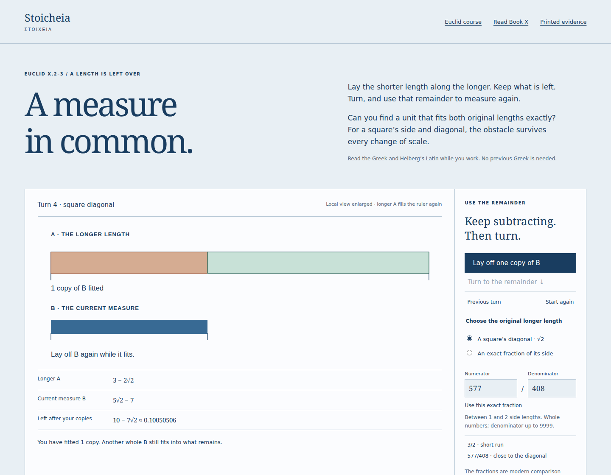
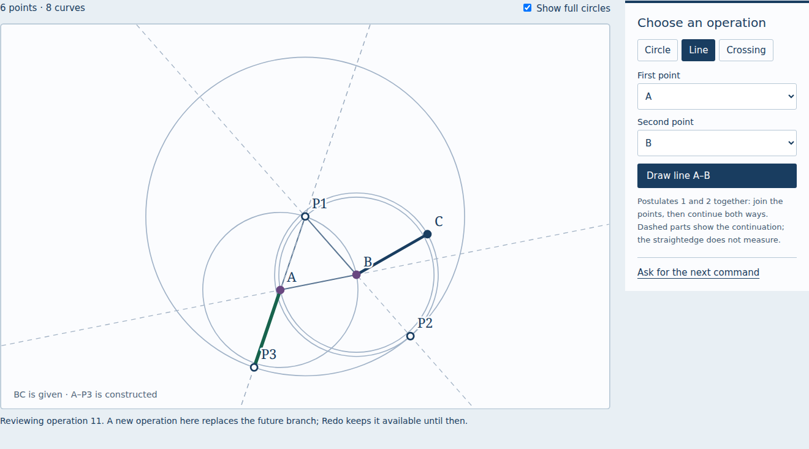
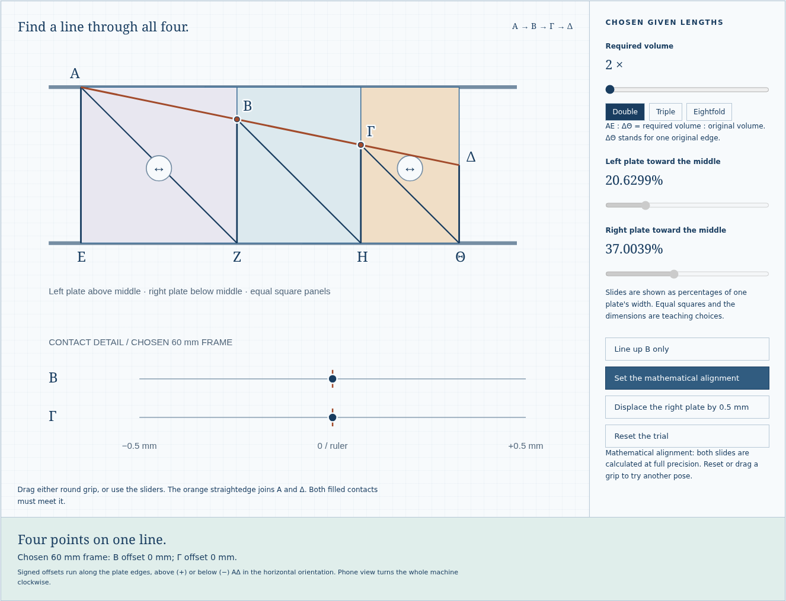
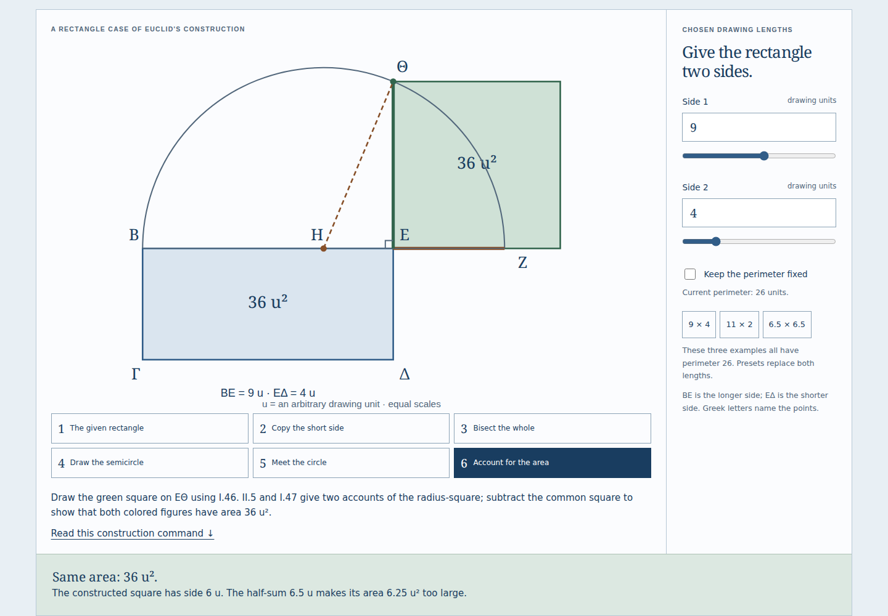
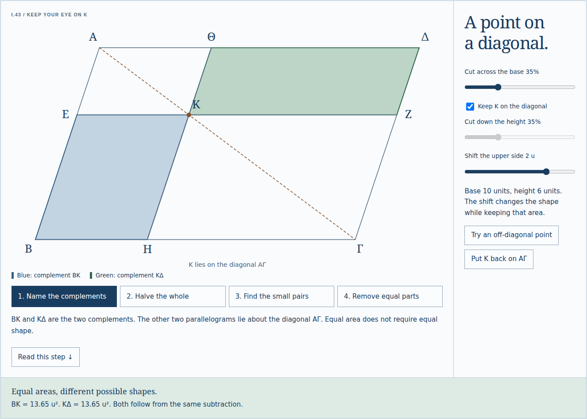
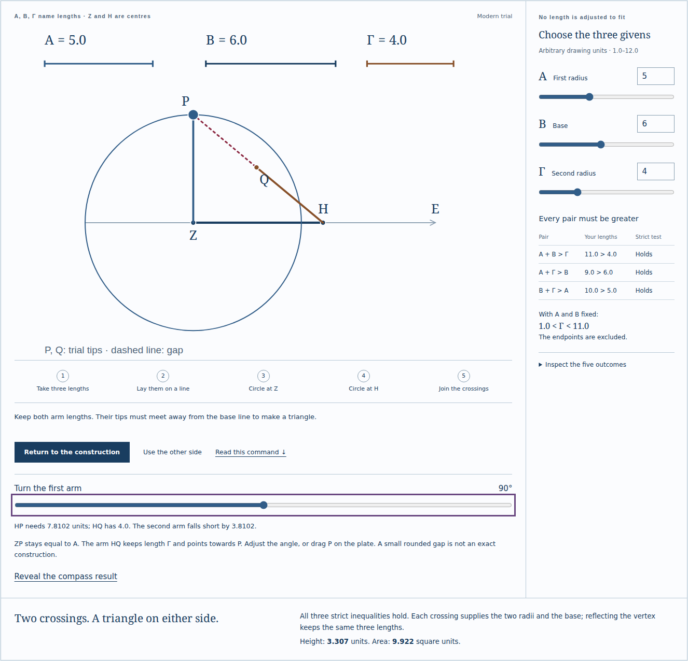

# Stoicheia

Read Euclid in Greek, Latin and English, with working diagrams, construction workshops and the original printed pages.

[](LICENSE)
[](https://antonsoo.github.io/stoicheia/)


A diagram can make Euclid look obvious while hiding the reason a step is allowed.
A translation can make the argument readable while hiding the Greek that carries
it. Stoicheia connects both: change the givens, follow the command on the plate,
read the two source languages, and ask what established the relation.

The opening course is **Book I, propositions 1–23**. It includes the complete
statements and proofs, divided into 189 aligned reading steps, with 55 selected
vocabulary entries, fourteen foundation statements and forty-six passage-based
reading exercises. It is intended for an English-speaking reader who knows basic
geometry and is beginning Greek or Latin.

**[Open the course](https://antonsoo.github.io/stoicheia/)** ·
[Source repository](https://github.com/antonsoo/stoicheia). The app is a static
site; no package registry installation is required.

## Copy the opening, through three lengths

The sequential course connects **[I.22](https://antonsoo.github.io/stoicheia/#p=22&s=7) to [I.23](https://antonsoo.github.io/stoicheia/#p=23&s=5&a=32&r=1.15&x=0.25)**. Construct a triangle from
three suitable lengths, then use that result to copy a given rectilinear angle
at a new point on a new line. I.8 supplies the final angle equality.
- Change the two arbitrary point distances: the auxiliary triangle changes,
  while the given and copied openings agree. Tilt the new baseline or choose
  the reflected copy; angular magnitude and orientation remain distinct.
- In I.22, inspect all three strict inequalities, including internal and external
  tangency. Keep failed givens visible instead of silently replacing them.
- Read both complete Greek/Latin/English proofs in fifteen aligned units, with
  four new contextual word notes and four passage-based reading exercises.
  The I.22 text reuses the existing authoritative workshop transcription.
- Inspect the original pages 52–57, save a complete illustrated study with its
  source images and font, and follow the earlier I.8 and I.22 results offline.

On phones, companion workshops open from a native disclosure, so the chosen
lesson and its plate arrive before a long list of secondary links. Definitions
and reading practice remain directly available.

[Source, geometry and review](docs/copying-review.md) ·
[Saved I.23 study, gzip](examples/stoicheia-I23-course.html.gz) ·
[Printed I.23 study](examples/stoicheia-I23-course.pdf).


## Shorter route, larger angle

**[Shorter route, larger angle](https://antonsoo.github.io/stoicheia/#p=21&s=9&m=55).**
Move an interior meeting point to compare the outer route with the two segments
inside it. Follow the intermediate route Β–Ε–Γ through two applications of I.20
and two of I.16. Each conclusion has its own proof. The individual-leg readouts
also show why the sum can shrink even when one inner segment grows.

Ten complete Greek/Latin/English steps, two position controls, two passage
exercises and the original pages 50–53 complete the sequential course through I.21.
[Model and review](docs/nested-review.md) · [Saved study](examples/stoicheia-I21-study.html) ·
[Printed study](examples/stoicheia-I21-study.pdf).

## A measure in common

The [common-measure workshop](https://antonsoo.github.io/stoicheia/measure.html)
reads **Euclid X.2–3**. Lay off lengths, keep the remainder, and distinguish
finding no common measure yet from proving that none can exist.
[Public source, hosted files and browser verification](docs/measure-publication.md).



Lay the shorter length along the longer, then turn to the remainder. Try
**3/2**: the final half-side measures the original lengths three and two times.
Then compare **577/408** with the square's diagonal:

| Turn 8                   | Exact fraction 577/408           | Square diagonal                                    |
| ------------------------ | -------------------------------- | -------------------------------------------------- |
| Copies that fit          | 2                                | 2                                                  |
| Remainder                | Exactly zero                     | 577 − 408√2, strictly positive                     |
| What the run establishes | A greatest common measure, 1/408 | No conclusion of “never” from the finite run alone |

The inputs agree to four decimal places and share eight successive copy
counts. Their outcomes still differ. An exact self-similarity argument supplies
the infinite condition the diagonal needs; twenty-four unfinished turns do not.
The original ruler keeps the shrinking lengths at one scale while the active
view magnifies them. Positive subpixel lengths are marked without pretending
the marker's width is the length.

Ten Greek/Latin/English reading units explain a shared measure, the changing
roles of greater and smaller, and **μηδέποτε / nunquam**, “never”. Twelve complete
pages from Heiberg's **1886 volume III** retain the first definitions, X.1–3,
apparatus and scanned annotations. The squares on the side and diagonal share
an area measure even though the lengths do not. A language note also explains
why Book X's `rationalis` is not modern rational-number terminology.

Keep a link to a partial turn, an exact-coefficient CSV, a ruler SVG, or one
script-free illustrated HTML reading containing the proof, all readings, scans,
font and licenses. The production edition saves the new room and its sources
offline; the source viewer and export refuse a substituted image.

[Source and model](docs/measure-model.md) · [Review and evidence](docs/measure-review.md) ·
[Actual saved reading, gzip-compressed](examples/common-measure.html.gz) ·
[30-page PDF](examples/common-measure.pdf) · [Exact record](examples/common-measure.csv).
Extract the HTML before opening it. These artifacts preserve a diagonal run at
turn eight, alongside the distinct terminating fraction comparison.

```sh
npm run verify:measure
npm run verify:measure-sources -- --pdf /path/to/HeibergEuclidVolume_3.pdf
npm run test:measure -- /tmp/stoicheia-measure
python3 scripts/measure-oracle.py --browser /tmp/stoicheia-measure/review.json
python3 scripts/measure-print.py /tmp/stoicheia-measure/chromium-1440/reading.pdf
```

The arithmetic review uses Python's `Fraction` and 110-digit `Decimal` without
importing the app. It checks 5,556 examples, including 25,730 complete turns and
77,190 exact length readings. Source reproduction requires Poppler; omit `--pdf`
to download the identified original. Browser review needs the existing Playwright
Chromium and Firefox installations. It starts its own production servers and
checks desktop/phone controls, keyboard focus, native downloads, saved files,
source/history navigation and origin-disabled offline use. Build `dist/` first
and keep it unchanged during that review.

## Make I.2 yourself

The [construction desk](https://antonsoo.github.io/stoicheia/desk.html) turns I.2 into a task you perform.
Choose existing points, draw a centre-and-point circle or a straight line,
and keep the crossing you need. There is no radius field or automatic length
transfer. Undo, branch from an earlier operation, and replay your own transcript.



A matching rounded measurement does not complete the task. The desk recognizes
the actual I.2 dependencies: equal triangle sides, equal circle radii, and the
two crossings beyond A and the reference anchor. Aligned bars show the equal
parts removed from the equal wholes. Either equilateral vertex and either
endpoint of BC work; other valid constructions may have no recognized chain.
- Three layouts, native keyboard controls and optional next-command hints.
  Setting up a hint leaves execution to the reader.
- The complete I.2 Greek, Latin and English reading, connected to your point
  names and four full printed pages.
- Save/reopen drawing JSON, share the current operation, export SVG, or save
  a script-free HTML reading with every intermediate diagram, text, font and
  verified source images. The app's complete six-room edition works offline.

The desk is published with the complete course. [Publication evidence](docs/desk-publication.md)
separates the reviewed source, Pages commit, public file identities and actual
browser workflows. `npm run build` writes the complete site to `dist/`.

[Editable example](examples/stoicheia-construction.json) ·
[Drawing](examples/stoicheia-construction.svg) ·
[Complete saved reading](examples/stoicheia-construction-reading.html) ·
[Printable PDF](examples/stoicheia-construction-reading.pdf) ·
[Model, limits and direct review](docs/desk-review.md).

## Twice the stone, with sliding plates

The **[mesolabe workshop](https://antonsoo.github.io/stoicheia/mesolabe.html)**
follows the construction transmitted by Eutocius under Eratosthenes' name.
Doubling every cube edge gives eight times the volume. Sliding three plates
until four points align instead finds the two mean proportionals that give
a cube root.


- Drag either plate or move it with a keyboard. Align only Β and watch Γ
  remain wrong; compare both contacts against the same straightedge.
- Read all four lengths, their three successive ratios and the volume of
  the cube implied by your selected ΓΗ. Try a chosen 0.5 mm displacement
  and see how the volume changes.
- Follow the similar-triangle argument through both families of parallel
  lines. Read eight Greek/Latin/English excerpts with contextual word notes
  and inspect twelve complete pages of Heiberg's **1881** edition.
- Save your pose as an illustrated HTML reading with every source image
  and its Greek font embedded, or export SVG and CSV. A landscape A4
  paper exploration sheet provides loose plates and a calibration bar.
  The app and all five rooms work offline after the complete edition is saved.

The model assumes exact parallel rails and zero-thickness square plates.
It is a mechanical operation beyond the course's straightedge-and-compass
constructions. The letter's attribution is preserved without resolving its
authenticity. Physical printing, cutting, assembly and achievable precision
remain unverified.

[Source and geometry](docs/mesolabe-model.md) · [Review](docs/mesolabe-review.md) ·
[Saved reading](examples/stoicheia-mesolabe-reading.html) ·
[Printable reading](examples/stoicheia-mesolabe-reading.pdf) ·
[Paper exploration sheet](examples/stoicheia-mesolabe-paper.svg) ·
[Measurements](examples/stoicheia-mesolabe-measurements.csv).

## A square, with nothing added

The **[II.14 workshop](https://antonsoo.github.io/stoicheia/quadrature.html)** turns
a rectangle into a square of equal area.

A 9 by 4 rectangle has area 36. Averaging its sides gives 6.5, whose square
has area 42.25. Euclid's semicircle instead gives side 6. Move the rectangle's
two pieces to see the missing 6.25-unit corner, then follow two accounts of
the same area and subtract the square they share.


- Change both sides or hold the perimeter fixed; inspect the already-square
  branch and the difference between equal area and equal perimeter.
- Read the complete II.14 in Greek, Heiberg's Latin and new English, with eleven
  reading notes and four source-based questions. Compare the Greek prose with
  the equations used by the nineteenth-century Latin translator.
- Inspect eight full printed pages. Save the construction, complete reading,
  font and all scans as one portable HTML file, or export SVG and CSV.
- Follow the linked course and I.22 construction offline with the new room.

The workshop implements the rectangle case, with I.45's earlier conversion of
an arbitrary rectilinear figure stated as a prerequisite. The moving pieces
are a modern illustration of the II.5 relation.

[Source and model](docs/quadrature-model.md) · [Review](docs/quadrature-review.md) ·
[Saved reading](examples/stoicheia-II14-reading.html) ·
[Printable reading](examples/stoicheia-II14-reading.pdf) ·
[Construction SVG](examples/stoicheia-II14-construction.svg) ·
[Measurements](examples/stoicheia-II14-measurements.csv).

## Equal leftovers, unequal shapes

The [equal-complements workshop](https://antonsoo.github.io/stoicheia/gnomon.html)
follows the complete **I.43 and II.5** behind the extra-square relation.



Move the meeting point along a parallelogram's diagonal: the two leftover
regions keep equal areas despite their different shapes. Move it off the
diagonal and the areas become 7.35 and 25.35. Each small triangle pair still
has equal area; what fails is the subtraction from the two large halves.

Then follow Euclid's original gnomon through three equal additions. Read all
eighteen Greek/Latin/English units with ten complete printed pages, including
Heiberg's note about the diagram's duplicated Μ. A saved reading keeps both
experiments, source images, font and measurements together.

[Source and model](docs/gnomon-model.md) · [Review](docs/gnomon-review.md) ·
[Saved reading](examples/stoicheia-gnomon-reading.html) ·
[Printable reading](examples/stoicheia-gnomon-reading.pdf).

## Three lengths: can they close?

Open the [I.22 construction workshop](https://antonsoo.github.io/stoicheia/triangle.html).
It is also available locally after starting the app.
The sequential course now reaches I.21; this separate workshop completes I.22.
[Review, sources and publication boundary](docs/closure-review.md).



Try Α = 10, Β = 6, Γ = 4. The two radii exceed the base, but the circles
only touch internally: there is no triangle. Increase Α to 10.1 and one
circumference lies entirely inside the other. All three strict comparisons
matter, including the one that this tempting single check misses.
- Change all three lengths independently, in exact tenths from 1.0 to 12.0.
  Inspect two crossings, both tangencies and both ways the circles can miss.
- Turn a trial hinge with the keyboard or drag its tip. The second arm keeps
  its length; the visible gap and signed mismatch explain why it has not closed.
- Follow the source's five construction stages, choose the reflected vertex,
  and connect the result to the same-side condition in I.7 and the inequality
  in I.20.
- Read the complete I.22 in nine Greek/Latin/English units, with language notes,
  three reading questions and the four original printed pages. Heiberg's brackets
  and the absent Latin translation of one bracketed explanation stay explicit.
- Save the measured SVG, CSV, or an illustrated HTML reading containing its own
  font and scans. The portrait plate makes the labels readable on phones.
  Both the course and workshop work offline once the edition is ready.

[Saved reading](examples/stoicheia-I22-reading.html) ·
[Printable reading](examples/stoicheia-I22-reading.pdf) ·
[Measurements](examples/stoicheia-I22-measurements.csv).
These are actual browser exports. [Hosted verification](docs/closure-hosted.json)
records the exact build bytes, direct browser downloads and offline navigation.

## Run it

Node.js 24 or later:

```sh
git clone https://github.com/antonsoo/stoicheia.git
cd stoicheia && npm ci
npm run dev
```

Open `http://127.0.0.1:4327/stoicheia/`. The production build is `npm run build`,
which writes a complete static site to `dist/`. `npm run preview` serves that build
on the same port; stop the development server before starting the preview.

## Read, construct, inspect

| Proposition | What you make                                                 | What the lesson exposes                                                                                 |
| ----------- | ------------------------------------------------------------- | ------------------------------------------------------------------------------------------------------- |
| I.1         | Equilateral triangle on a given segment                       | The two radius equalities, common notion 1, and the unstated intersection assumption                    |
| I.2         | An equal length at a separate point                           | The equilateral triangle supplies equal parts to subtract from equal radii                              |
| I.3         | A part of the longer segment equal to the shorter             | I.2 becomes an available construction, and the greater–lesser hypothesis matters                        |
| I.4         | Triangle congruence from two sides and the included angle     | Rigid superposition, corresponding vertices, and an unstated motion assumption                          |
| I.5         | Equal interior and exterior base angles                       | Two overlapping triangle comparisons, then subtraction of equal angles                                  |
| I.6         | Equal sides from equal angles                                 | A contradiction, with the impossible conjunction explicitly distinguished from the measured sketch      |
| I.7         | Uniqueness of a meeting point on one side of a base           | The same-side restriction, a conditional equality, and the printed proof’s placement assumptions        |
| I.8         | Congruence from three side pairs                              | The angle is earned; impossible three-length inputs do not fabricate a triangle                         |
| I.9         | An internal angle bisector                                    | One circle crossing works throughout; the other can work, collapse, or point outward                    |
| I.10        | Equal halves of a segment                                     | Earlier constructions reuse two circles, and their intersection earns the midpoint                      |
| I.11        | A perpendicular from a point on the line                      | Equal adjacent angles are proved with I.8, then named right by definition 10                            |
| I.12        | A perpendicular from an exterior point                        | The other-side condition guarantees a chord; altered choices can miss, touch, cross or have zero radius |
| I.13        | A linear pair equal to two right angles                       | Two groupings of the same three parts; a separate branch handles equal adjacent angles                  |
| I.14        | A straight continuation from its angle condition              | A different supposed continuation forces unequal remainders to be equal                                 |
| I.15        | Equal vertically opposite angles                              | Subtract one angle from two equal linear-pair totals; preserve the Greek-only corollary                 |
| I.16        | An exterior angle greater than either opposite interior angle | Two midpoint constructions place copies of the interior angles inside the exterior                      |
| I.17        | A bound for any two interior angles                           | I.16 and a straight pair give a strict bound without the later angle-sum theorem                        |
| I.18        | A greater angle from a greater side                           | An interior cut supplies an isosceles triangle; equality or a shorter side stops the construction       |
| I.19        | The converse: a greater side from a greater angle             | Equal-side and shorter-side alternatives visibly lose the given angle premise                           |
| I.20        | Any two sides together exceed the third                       | Copy a side onto a continuation, use I.19, and expand all three comparisons                             |
| I.21        | An interior route is shorter but includes a greater angle     | Two triangle inequalities and two exterior-angle comparisons through the same intermediate point        |
- Move through the commands and deductions at your own pace. Every step names its
  permission: postulate, definition, common notion, earlier proposition, or
  assumption. Earlier constructions can be opened from the reason that uses them.
- Select underlined Greek or Latin words for a lemma, equivalent, transliteration
  and explanation of the forms. The reading notes explain selected syntax in
  context, including the difference between commands and completed results.
- Read Greek-first or Latin-first and reveal the other languages when ready.
  Thirty-two exercises ask about the wording of actual passages, explain each
  interpretation, and return you to the corresponding step.
- Open a reason’s source to compare the definition, postulate or common notion
  in all three languages. The reader distinguishes Heiberg’s numbering from the
  usual five-item common-notion list.
- Change the given lengths with keyboard-accessible sliders. Flip the triangle,
  or change the reference angle in I.2. In I.3, a reference of 100% or more fails
  the stated hypothesis and withholds the constructed cut.
- In I.4, move one triangle onto the other with a shape-preserving rotation and
  translation. In I.5, trace each of the compared triangles and follow the
  whole-angle / removed-part / remainder table. I.6 keeps its temporary
  supposition visibly separate from the original given, including in downloads.
- Move I.7’s second candidate while retaining its first distance, then reflect
  it across the base to see why the same-side hypothesis matters. In I.8, choose
  three lengths and compare the triangles by rigid motion.
- Open I.7’s [missing-case exploration](https://antonsoo.github.io/stoicheia/#p=7&case=1&turn=55&case-step=2).
  Move Δ into the first triangle, find why the printed whole-and-part reason
  stops fitting, and repair it with I.5’s exterior angles. Inspect the exact
  boundary, reflection and coincidence too. Share a placement or save its
  complete argument and the Greek/Latin clause as a standalone case study.
- Explore both circle crossings in I.9 at 40°, 60° and 90°. The alternate ray
  can bisect, vanish or lie outside the given angle. I.10 then reuses the circles
  to construct a midpoint from I.1, I.9 and I.4.
- In [I.12](https://antonsoo.github.io/stoicheia/#p=12&s=8), move the auxiliary point across the line. Compare a miss, tangency and two crossings, and see why the original other-side choice guarantees the chord. The midpoint comes from I.10, not a projection assigned as a construction permission.
- In [I.14](https://antonsoo.github.io/stoicheia/#p=14&s=5), the sketch keeps the original angle premise and draws the supposed continuation off the line. Its measurements remain unequal; the contradiction's forced equality is explicitly conditional, including in downloads.
- In [I.16's second construction](https://antonsoo.github.io/stoicheia/#p=16&s=8), make the work hidden by “similarly” visible. The modern labels Θ and Κ expand the source's abbreviated instruction. Neither inequality uses the later triangle-angle-sum theorem.
- Open the printed page for either language, zoom it and pan with the keyboard.
  All fifty-four source pages are bundled. The full aligned passage is available below
  the plate, with links back to individual steps.
- Share the current proposition, step and parameters in a URL fragment. Save the
  current diagram as SVG or the entire lesson as an illustrated HTML study. The latter includes its verified source pages (including cited foundations), a Greek font and redistribution notices. It opens from disk without external requests.
  The downloaded sheet contains the diagram, all three languages, reasons, relevant foundation statements, notes and
  attribution, and opens without scripts or network access.
- Browser printing produces the full parallel passage, even when it is collapsed
  on screen, and restores the previous reading state afterward. An actual
  [I.5 print PDF](examples/stoicheia-I5-reading.pdf) is included. Use the study-sheet
  download when you also want the diagram, reasons and notes.
- The production edition precaches its text, diagrams, font and source pages.
  Wait for “Edition ready offline” before disconnecting. Offline reloads require
  HTTPS or localhost and a browser that permits service workers. Development mode
  deliberately does not install an offline worker. Readiness is checked against
  the edition currently open; an older active worker cannot certify a newer
  course. Each precached file must also match its build-time SHA-256 before
  the worker activates. An open tab offers a reload when a different edition
  takes control.


A [downloaded I.2 study sheet](examples/stoicheia-I2-study.html) is included as a
working example, alongside [I.6’s contradiction sheet](examples/stoicheia-I6-study.html),
[I.9’s outward-ray exploration](examples/stoicheia-I9-opposite-ray.html), and
[I.10’s midpoint construction](examples/stoicheia-I10-study.html),
[I.14’s hypothetical continuation](examples/stoicheia-I14-hypothetical.html), and
[I.16’s complete study sheet](examples/stoicheia-I16-study.html) ([PDF](examples/stoicheia-I16-study.pdf)). Save a sheet and
open it directly in a browser to read without the app.

## The source is part of the lesson

The Greek and Latin are transcribed from J. L. Heiberg’s _Euclidis opera omnia_,
volume I (Leipzig: Teubner, 1883), printed pp. 2–57. Heiberg’s Latin is a
**nineteenth-century translation**, not an ancient Latin text. The English is a
new reading translation; explanations sometimes make an implied intersection
explicit. Point names remain Greek throughout.

The [University of Toronto scan](https://archive.org/details/euclidisoperaomn01eucluoft)
is public domain. The page images and download hashes are recorded in
[`public/sources/manifest.json`](public/sources/manifest.json). The
[editorial note](docs/sources.md) records normalized glyphs, omitted reference
marks, the retained editorial brackets, the clipped margin on p. 6 and how the source diagrams differ from the
working plates. Critical apparatus is visible on the scans but is not transcribed
into the reader.

Mathematical notes were cross-checked against David E. Joyce’s commentary at
Clark University: [I.1](https://mathcs.clarku.edu/~djoyce/elements/bookI/propI1.html),
[I.2](https://mathcs.clarku.edu/~djoyce/elements/bookI/propI2.html),
[I.3](https://mathcs.clarku.edu/~djoyce/elements/bookI/propI3.html),
[I.4](https://mathcs.clarku.edu/~djoyce/elements/bookI/propI4.html),
[I.5](https://mathcs.clarku.edu/~djoyce/elements/bookI/propI5.html),
[I.6](https://mathcs.clarku.edu/~djoyce/elements/bookI/propI6.html),
[I.7](https://mathcs.clarku.edu/~djoyce/elements/bookI/propI7.html),
[I.8](https://mathcs.clarku.edu/~djoyce/elements/bookI/propI8.html),
[I.9](https://mathcs.clarku.edu/~djoyce/elements/bookI/propI9.html),
[I.10](https://mathcs.clarku.edu/~djoyce/elements/bookI/propI10.html).

## How the construction works

The core is separate from the reading content and interface. I.1 computes either
circle intersection on the base segment. I.2 actually constructs its return
point; it does not simply assign the reference length to a new segment.

Using the common English label convention for the following diagram only:

```text
          D
         / \
        A---B       DA = DB       (I.1)
       /     \
      L       G     DL = DG       (circle at D)

     DL - DA = DG - DB
        AL  =  BG = BC           (equal remainders, then equal radii)
```

`transfer(a, b, c)` first constructs D, intersects the extended DB with the circle
at B through C to obtain G, then uses the circle at D through G to obtain L on
extended DA. In a calculated teaching example with AB = 180 and BC = 117, the calculation
gives DL = DG = 297, DA = DB = 180, and AL = BC = 117. I.3 calls that construction
and uses its output as the radius of the circle locating the cut.

SVG coordinates are computed from the geometry; equality marks follow established
arguments. The numerical table is explicitly a check in relative units. It is
not used as the reason an equality holds.

The app uses TypeScript and Vite, with no runtime framework or network service.
The production build generates a content-versioned service worker. Text is escaped
before markup is created; URL state accepts bounded numeric parameters only. The
font and its license are self-hosted. There is no analytics, remote font request
or stored reading history.

## Verification

```sh
npm run check
npm run verify:oracle
npm run verify:triangles
npm run verify:bisections
npm run verify:right-angles
```

The TypeScript checks cover constructions, invalid hypotheses, complete lesson
scenes, shared-state parsing, inflected vocabulary and exports. More importantly,
an independent Python standard-library oracle uses 60-digit `Decimal` arithmetic
and general circle-circle and quadratic line-circle intersections to reproduce
the points without importing the app code.

The retained [oracle result](docs/geometry-oracle.json) has 720 input cases,
4,320 point comparisons and 5,760 equality checks. Maximum relative coordinate
error is `1.1526305883259686e-15`, below the `2e-12` tolerance. These inputs rotate,
translate and resize the constructions and exercise both triangle orientations.

A second [independent check](docs/triangle-oracle.json) uses cosine-law angles,
shoelace areas and Euclidean distances to inspect 480 I.4 motion cases, 96 I.5
constructions and 96 I.6 hypothetical sketches. All 8,064 checks passed. It verifies
both I.5 triangle correspondences and the final angle subtraction, and requires
I.6’s scalene sketch to have unequal base angles and a strictly smaller inner
triangle. These are numerical checks, not a formal proof checker.

The [bisection and uniqueness check](docs/bisection-oracle.json) independently
inspects 1,336 cases, including 112 impossible three-length inputs, both I.9
crossings and rotated I.10 constructions. Its 11,381 checks use cosine-law angles,
circle equations, ray directions and an arithmetic midpoint oracle. I.9’s I.3
length-copy result is also checked; agreement is not inferred from rounded labels.

The [right-angle oracle](docs/right-angle-oracle.json) checks **2,130 cases** with
21,030 comparisons. It independently solves a general line/circle quadratic,
checks I.10's result against analytic midpoints/projections, and verifies both
I.16 angle copies by central reflection and strict determinant-based containment.
The 1,680 circle cases include 180 misses, 30 tangencies and 30 zero-radius
choices. Maximum relative coordinate error is `3.303e-14`. A translated tangency
exposed cancellation error; the classifier now includes coordinate scale in its
rounding tolerance and withholds a chord at an unresolved contact.

For browser verification, serve the production build with `npm run preview`, then
run `npm run test:browser` in another terminal. Playwright needs matching Chromium
and Firefox browsers already available. On a new development machine they can be
installed with `npx playwright install --with-deps chromium firefox`.

The [I.21 review](docs/nested-review.md) records 648 independent geometry cases,
its drawn comparisons, printed readings and actual browser workflows. Reproduce
the geometry with `npm run verify:nested` and the browser journey with
`npm run test:nested -- http://127.0.0.1:4327/stoicheia/`.

The earlier [I.17–20 review](docs/inequalities-review.md) links the new clean
build, independent geometry, rendered-browser, print and offline-upgrade
receipts, with downloadable I.19/I.20 study sheets. Earlier receipts below
remain records of their own editions.

The [browser receipt](docs/browser-verification.json) records the tested browser
versions, desktop and 375px viewports, rendered side equalities, source-page
navigation, vocabulary focus return, invalid-length handling, shared links,
standalone downloads, offline reloads with the local origin unavailable, accessibility
audits and exact HTTP/build
byte comparisons. The separate [publication receipt](docs/publication-verification.json)
records exact file hashes served by GitHub Pages and direct hosted
workflows in both browsers at both screen sizes. Neither receipt is a remote CI
result.

The [I.11–16 build record](docs/right-angle-build.json) identifies the clean
source archive and its 52 output files. The [edition-upgrade receipt](docs/right-angle-upgrade.json)
checks an existing ten-proposition reader upgrading to sixteen: a held or failed
page-45 download never produces a false readiness promise, and the recovered
edition reopens I.16 and the exact scan with the origin unavailable.

The development quickstart is checked separately with `npm run test:dev` while
`npm run dev` is running. Its [receipt](docs/quickstart-verification.json) checks
the actual styled layout and navigation in Chromium and Firefox. CSS is loaded
through an HTML stylesheet link so Vite development works with the same
`style-src 'self'` policy as the production site.

The [print receipt](docs/print-verification.json) checks thirty-two actual Chromium
PDFs (each proposition with its passage initially open and closed). Poppler’s
`pdftotext` recovered every source-language and English paragraph and every step
title. Reproduce with `node scripts/print-check.mjs` against the preview server;
this additional check requires Poppler. Firefox print media and state restoration
are checked separately; the receipt does not claim a native Firefox PDF.

The [upgrade review](docs/offline-upgrade.md) records a reproduced false-readiness
bug: the new I.10 page claimed to be saved while its download was pending, then
reloaded the older six-proposition course offline. The fix checks the controlling
edition and its complete file inventory. Delayed and failed downloads, recovery,
source-image bytes and updates to an already-open tab are exercised in real
Chromium and Firefox sessions.

A [mixed-response review](docs/mixed-edition.md) also reproduces successful HTTP
responses containing an older entry page or the wrong source scan. The install
now verifies each file’s bytes before activation and recovers after a failed
first installation. The review retains the blank-reader and wrong-page failures,
corrected offline reloads and the clean-build evidence. Its separate
[hosted receipt](docs/mixed-edition-publication.json) verifies the published repair.

The [I.7 case-study review](docs/case-study.md) covers the added interior-case
exploration, its separate numerical oracle (`npm run verify:cases`), downloaded
studies, source-clause reading and shared-link landing behavior.

The [I.11–16 review](docs/right-angles-review.md) records the source decisions,
construction boundaries, rendered geometry, new downloads and print coverage.
The I.15 Greek corollary stays bracketed and explicitly has no supplied Latin;
it is also retained in the full reading's print output.

## Illustrated studies you can keep

Every course lesson can now save its own source images and Noto Serif font in
one HTML file. The proof, reasons, selected diagram, cited foundation passages
and relevant facsimiles remain together offline. Images and font bytes must
match the current edition before the download is offered. Failed reads can be
retried; changing lessons during a save does not alter the saved snapshot.

The same verification now protects the I.22 workshop. An earlier export accepted
a substituted HTTP-200 image under the wrong page caption; that case now refuses
the download. [Actual file workflows and limits](docs/illustrated-review.md).

## Accuracy and limitations

- The sequential course covers I.1–23; the separate I.22 workshop adds a trial hinge and finer length controls.
  This is not the whole _Elements_. The construction tools, translations
  and selected vocabulary are complete for that scope. There is no general Greek
  parser, pronunciation model or claim that every word is annotated.
- The Greek follows a modern printed critical edition, not a surviving autograph
  of Euclid. Transcription and language notes merit philological review. Source
  scans are supplied so errors can be identified and corrected.
- Numerical constructions use floating-point coordinates in the real plane.
  Independent numerical agreement and sampled browser checks are not formal
  verification of Euclid’s postulates. The I.1 intersection gap and I.4 superposition assumption are explicitly
  discussed; the app does not claim to derive those assumptions from the postulates.
- I.7’s printed proof treats a particular placement of the second meeting point;
  the reader names that limitation and offers a separate modern exploration of
  the interior case, based on Heath’s commentary. Its fixed family of placements
  is not an exhaustive case classification. I.8’s hypothetical displaced apex is not drawn
  with impossible equal-distance claims. I.9’s alternate choices explicitly
  distinguish equal angles from an internal bisection.
- I.13's controls follow the printed unequal-angle arrangement and include its separate right-angle branch. I.14's temporary continuation cannot satisfy every premise simultaneously. I.16's Θ/Κ drawing is a modern expansion of the source's “similarly,” not an additional ancient diagram or text.
- I.17 and I.20’s additional pair drawings expand “similarly” with modern diagrams. I.19’s temporary triangles deliberately fail the given angle inequality. The readouts check the numerical drawings; they are not proof premises.
- I.21’s position controls keep Δ strictly inside the outer triangle, away from degeneracy. The numeric degree and length readings illustrate the two proofs; the ordering/intersection assumptions are explicit.
- I.2 reuses the completed I.1 subconstruction, and I.3 reuses I.2. Their internal
  working is shown in the corresponding earlier lesson rather than repeated in
  the later plate. Some unused source-circle labels are omitted from the plates.
- “Collapsing compass” is a modern model of the restricted operation. The app
  makes no historical claim about a physical ancient instrument.
- Storage may be unavailable or cleared by the browser. Offline readiness applies
  to the cached build, not to linked external commentary or the complete volume.

## Contributing

See [CONTRIBUTING.md](CONTRIBUTING.md). Corrections tied to a printed page and
line, or a reproducible geometric counterexample, are especially useful.

## License

[MIT](LICENSE) for code, English and teaching notes. Source Greek, Latin and page
images are public domain. Noto Serif uses the SIL Open Font License; see
[third-party notices](THIRD_PARTY_NOTICES.md).
