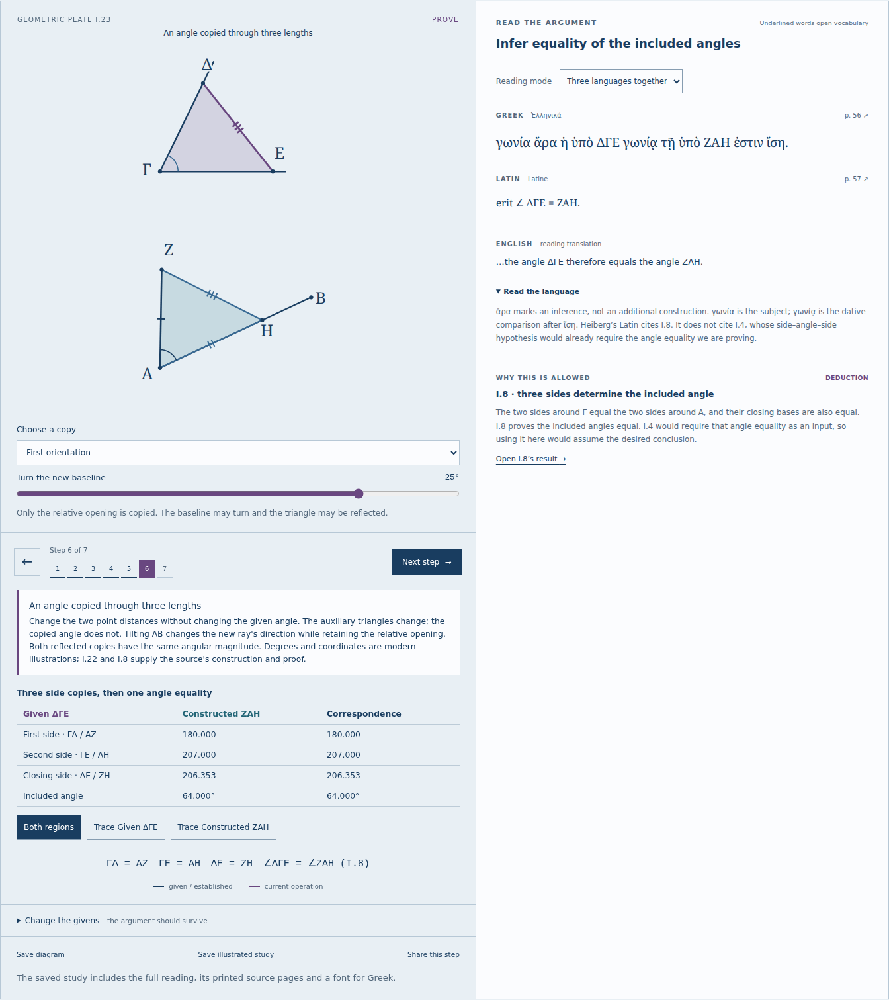

# Copy the opening through three lengths

The sequential course connects [I.22](https://antonsoo.github.io/stoicheia/#p=22&s=7)
and [I.23](https://antonsoo.github.io/stoicheia/#p=23&s=5&a=32&r=1.15&x=0.25).
I.22 turns three suitable lengths into a triangle. I.23 turns that construction
into a way to make a given angle at a new point on a new line.

Choose the two arbitrary point distances on the given angle. Change them
independently: both auxiliary triangles change, but their included openings
agree. Tilt the new baseline or choose the reflected triangle. The orientation
may differ while the angle magnitude stays equal. The three side copies are
shown before the angle equality is introduced; I.8 supplies that final inference.
Using I.4 here would require the equality being proved.



I.22 keeps unsuitable lengths visible. Check all three strict inequalities:
two separate circles, external tangency, containment and internal tangency
are different failures. A point of contact has zero height and supplies no
genuine triangle. The existing separate I.22 workshop remains available for
its unconstrained trial hinge and finer length controls.

On phones the secondary workshops now open from a native disclosure. The
chosen lesson and its plate arrive before the long list of secondary links.
Definitions and practice remain directly accessible. Desktop navigation stays
expanded. The [375px view](assets/copying-phone.png) shows the actual lesson.

## Text and drawing

The course now has 23 propositions, **189 aligned reading steps**, **55 selected
word notes**, fourteen foundation statements and **46 reading exercises**.
I.22 reuses the complete authoritative workshop transcription rather than
maintaining a second copy. I.23 adds the complete statement and seven proof
units in Greek, Heiberg Latin and new English. Four notes and four exercises
connect the languages to the actual point choices and strict side conditions.

The source is Heiberg's 1883 volume I: Greek printed pp. 52,54,56 and Latin
pp. 53,55,57. The original PDF is 20,890,632 bytes with SHA-256
`da285c581c2dda86e2b25e20db3ce604bf6fb8765228fcd71cfc89d47a9d1c17`.
Printed pages 56 and 57 correspond to PDF pages and Archive leaves 70 and 71.
Both new full-page JPEGs were reproduced byte for byte with Poppler 24.02,
maximum dimension 1550 and quality 88. The scans also contain the beginning of
I.24; that proposition is outside this course.
[Manifest](../public/sources/manifest.json) · [Transcription decisions](sources.md#three-lengths-and-an-angle-i2223).

The Greek `Εἰλήφθω` is a singular perfect passive imperative with neuter plural
`σημεῖα`; Latin instead uses plural `sumantur`. `τυχόντα` / `quaelibet` permits
arbitrary points, with no requirement that their distances agree. Latin's
nineteenth-century date, the modern English, omitted inline references and
editorial reading divisions remain explicit.

`courseTriangle` classifies the circles using integer side percentages before
taking square roots. Its height uses the factored Heron expression. Missing
intersections never acquire an invented vertex. The complete circle extents
and the three given bars fit the stable reading frame.

`copiedAngle` first derives the three lengths of ΔΓΕ. In coordinates local to
the destination baseline, the new vertex has
`x = (ΓΔ² + ΓΕ² - ΔΕ²) / (2ΓΕ)` and
`y = ±sqrt(ΓΔ² - x²)`. It is then rotated with the baseline. The destination
does not reuse the input angle to position its new ray. I.8 justifies the
angle equality in the proof; the numerical construction illustrates it.
The source does not contain our coordinates, degree readings, sliders or
reflected-copy selector. Neither the rendering nor these checks formally
establishes Euclid's incidence and continuity assumptions.

## Source identity and edition recovery

On the prior public course, a valid Greek p.52 JPEG substituted for Latin
p.53 remained visible under the caption **Latin translation**. The
[before receipt](copying-review/viewer-before.json) records that actual hosted
reproduction with service workers blocked. HTTP success and image decoding
had not identified the page.

The course viewer now checks the retained byte length and SHA-256 before
displaying a decoded page. Each request uses its own detached image and a
revision guard. Stale responses cannot commit to a later page selection;
zoom survives navigation, and restored browser-history pages reverify the
open viewer. The [deliberately reordered response review](copying-review/source-race.json)
holds p.53 while the user advances through 54 to 55, then releases 53. In both
engines the visible p.55 keeps its exact bytes and caption; returning to p.53
shows its exact bytes with zoom intact. A held source stays hidden, and a valid wrong JPEG produces a
visible identity error. Native studies use the same retained identities and
refuse an incomplete packet.

The previous worker also recreated an empty edition cache when asked to
inspect completeness after its cache had been deleted. The
[before receipt](copying-review/inspector-before.json) records the real old
worker, empty cache inventory, false reply and newly created cache. The new
inspection uses named read-only matches. All four upgrade cases delete the
new cache after their offline checks and verify that inspection returns false
without recreating it. This is a claim about the inspection message, not about
all historical workers or every possible fetch.

## Review

The [independent numerical check](copying-review/oracle.txt) covers **712
constructions and 18,324 comparisons**: decimal Heron areas, actual side
lengths, determinant angles, branch orientation, five circle cases and full
frame bounds. Python imports no application geometry. It requires all 712
cases, so a truncated producer cannot pass on a partial stream.

The [final browser review](copying-review/browser.json) operates Chromium
153.0.8010.12 and Firefox 155.0 at 1440 and 375px. It reads every new Greek,
Latin and English unit; operates real controls, keyboard, arbitrary distances,
tilt and both copies; checks all source pages 52–57 by the actual displayed
blob bytes; checks zoom and history recovery; completes the four new exercises;
downloads native HTML/SVG files; and opens each HTML file with no HTTP requests.
All seven rooms, the new source and native readings work with both browser
offline and the local origin stopped. No page errors, document overflow or
automated WCAG A/AA violations were reported; this is not full accessibility
conformance. The [rendered-coordinate check](copying-review/rendered-oracle.txt)
independently checks 32 actual browser SVG views with 96 distance, angle,
tangency and orientation comparisons.

The [six fault cases](copying-review/integrity.json) hold p.57 for 8.5 seconds,
substitute valid p.56 for p.57, or substitute p.52 for p.53 in both engines.
Incomplete editions never claim readiness; substituted viewer pages and
native exports are refused, then recover with the identified bytes. The
[four upgrade cases](copying-review/upgrade.json) start from the actual prior
seven-room I.1–21 build, retain its complete worker during held/failed installs,
reload an existing tab into the new edition, and open p.57 and save a native
study after the origin stops. The new cache inventory is complete and unique.

The final runtime is source **5c7e194**. A separate clone received a fresh
Node 24.22.0 `npm ci`, then a fast-forward to the final worker correction and
`npm run check`. All **128 output files / 31,026,680 bytes** match the checkout
build exactly. The 71 existing and added unit checks, lint and typecheck also
pass. [Build identities](copying-review/build.json).

The retained downloads are [I.22 HTML, gzip](../examples/stoicheia-I22-course.html.gz),
[I.22 PDF](../examples/stoicheia-I22-course.pdf), [I.22 SVG](../examples/stoicheia-I22-course.svg),
[I.23 HTML, gzip](../examples/stoicheia-I23-course.html.gz),
[I.23 PDF](../examples/stoicheia-I23-course.pdf) and [I.23 SVG](../examples/stoicheia-I23-course.svg).
Decompress HTML before opening it directly. The actual 18-page I.22 and 12-page
I.23 PDFs preserve all eight and six original source JPEGs respectively,
recovered byte for byte with `pdfimages`. Proof and language text remains
extractable. The first three I.23 printed pages were visually inspected.
[Download identities](copying-review/examples.json).

```sh
npm ci
npm run check
npm run verify:copying
npm run test:copying -- /tmp/stoicheia-copying
python3 scripts/copying-rendered-oracle.py /tmp/stoicheia-copying/review.json
python3 scripts/copying-source-check.py /path/to/euclidisoperaomn01eucluoft.pdf
node scripts/copying-integrity.mjs /tmp/stoicheia-copying-integrity.json
node scripts/copying-source-race.mjs http://127.0.0.1:4327/stoicheia/ /tmp/stoicheia-copying-race.json
node scripts/copying-upgrade.mjs /path/to/prior-I1-21/dist /tmp/stoicheia-copying-upgrade.json
python3 scripts/copying-print.py /tmp/stoicheia-copying/chromium-1440/I23-study.pdf --lesson 23
```

The full-course replay and public-file/browser receipts are recorded in the
[publication review](copying-publication.md) when that boundary is verified.
