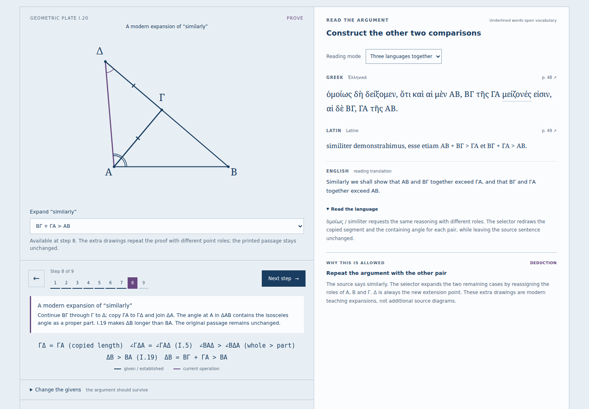
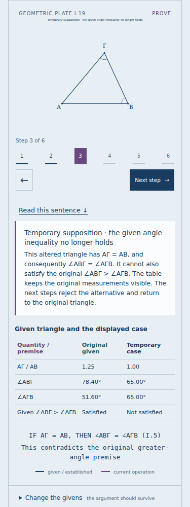

# Reading the triangle inequality as an argument

## What can be learned

The reader now reaches I.20. Its triangle inequality is earned through the
preceding propositions, with each source sentence beside the construction
or comparison that it licenses.

| Reading                                                       | What to try                          | What the diagram makes explicit                                                                                                 |
| ------------------------------------------------------------- | ------------------------------------ | ------------------------------------------------------------------------------------------------------------------------------- |
| [I.17](https://antonsoo.github.io/stoicheia/#p=17&s=5&pair=1) | Select each pair of angles           | An exterior angle plus the adjacent interior angle gives a straight pair; the selected two interior angles have a smaller total |
| [I.18](https://antonsoo.github.io/stoicheia/#p=18&s=5)        | Move ΑΓ through 100% of ΑΒ           | The internal cut disappears at equality; the small triangle needed by the proof would collapse                                  |
| [I.19](https://antonsoo.github.io/stoicheia/#p=19&s=2)        | Follow equal, shorter, then original | Each rejected side order forces an angle order incompatible with the original premise                                           |
| [I.20](https://antonsoo.github.io/stoicheia/#p=20&s=7&pair=2) | Construct all three side comparisons | Copying a side onto a continuation turns a sum into a single straight length, to which I.19 applies                             |

I.17 does not assume the later three-angle sum. I.20 does not assume that a
straight route is shortest. Degrees and relative lengths are measurements of
the modern drawing; the proof’s reasons remain the earlier results, the
whole–part principle, and the stated order rules.

## The source and the language

Greek and Latin come from the same Heiberg 1883 volume already used by the
reader. Printed pages 44–51 were checked visually; the six new full-page
images bring the offline collection to fifty pages. The Latin is Heiberg’s
nineteenth-century translation. The English, notes and drawings are new.

The new twenty-nine steps include eight passage exercises. They ask the reader
to interpret every choice of two, the conditional “would be,” the two rejected
alternatives, and the two sides taken together. Three new glossary entries
and additional inflected forms support those readings. The total course has
164 steps, 49 selected vocabulary entries and forty exercises.

[Source notes](sources.md#inequalities-i1720) distinguish the printed text,
Heiberg’s footnote, and the modern diagrams that expand “similarly.” The
underlying [image manifest](../public/sources/manifest.json) records PDF and
image hashes with exact printed/PDF-page correspondence.

## Premises remain visible

In I.18, equal or shorter ΑΓ removes Δ and the derived inequality. In I.19,
the equal-side and shorter-side sketches are labeled temporary suppositions;
the table shows which original angle premise they lose. The table headings
were corrected during visual review: the original triangle and temporary
case now label their actual numeric columns, including in saved readings.

The extra pair selector in I.17 and I.20 becomes available at “similarly.”
Earlier steps always show the source’s first construction. Returning to the
later step restores the chosen pair. Original Greek and Latin never change
with that choice. The saved link and downloaded SVG/HTML retain its diagram
and the notice identifying the expansion.

## Numerical and browser evidence

[The independent oracle](inequality-oracle.json) checks 1,620 I.20 copies and
270 I.18 cuts. Its sixty-digit normalized-vector calculations do not import
the application’s I.2/circle construction. It verifies copy lengths, segment
addition, isosceles angles and strict determinant containment across rotations,
reflections and acute/obtuse inputs. These are numerical comparisons, not
formal verification of Euclid’s axioms.

The browser review measures actual SVG points after native control changes,
checks equal scale on both axes, and follows each source passage. It also
checks invalid I.18 givens, all I.19 cases, comparison-state links, standalone
files, source-image bytes, narrow layouts and accessibility. The full-course
review additionally exercises all twenty lessons, all forty reading exercises
and all fifty source pages.

The [upgrade receipt](inequality-upgrade.json) starts with the old sixteen-
proposition offline reader. In both engines, a held or failed download of the
new page 51 leaves the edition pending. After recovery, an origin-disabled
reload opens I.20 and the exact new page bytes. An older ready service worker
is not accepted as evidence that the new edition has been saved.

[Four browser configurations](inequality-browser.json) each completed the 29
new steps and 129 rendered cases, checking 657 comparisons of geometry and labeled premises. The
checks include the final vocabulary explanation of `si minus` and native
keyboard popup focus return. No accessibility violations were reported in
the reviewed conclusion, temporary-case, source-dialog or standalone views.

[Forty actual print PDFs](inequality-print.json) cover every proposition with
the full passage initially open and closed. Independent Poppler text extraction
found every source/English paragraph and step title. Firefox print-layout
lifecycle checks are recorded separately from Chromium PDF generation.

## Take the reading away

- [I.20 illustrated study sheet](../examples/stoicheia-I20-study.html) and
  [PDF](../examples/stoicheia-I20-study.pdf): the third pair, complete proof,
  reasons, language notes and invoked foundation texts.
- [I.20 reading PDF](../examples/stoicheia-I20-reading.pdf): the complete
  trilingual passage in the reader's native print layout.
- [I.19 temporary-case sheet](../examples/stoicheia-I19-countercase.html):
  the changed triangle and the original premise remain explicitly separated.
- [I.20 standalone SVG](../examples/stoicheia-I20-third-pair.svg): its accessible
  description identifies the modern expanded construction.

## Build and publication boundary

[The clean build](inequality-build.json) contains 58 files totaling 15,399,693
bytes. A fresh archive of the runtime commit installed 29 packages under
Node 24 and passed the normal checks. Every output byte matches the reviewed
working build. The optional registry audit request stalled and was disabled
for the completed installation; no vulnerability-audit result is claimed.

The earlier sixteen-proposition receipts and examples remain records of that
edition. The new browser, print and upgrade receipts above describe this
addition. Source publication, canonical hosted bytes and hosted browser
behavior are recorded separately after deployment.

The final [full-course browser receipt](inequality-course-browser.json) records
164 steps per configuration, all forty passage exercises, all fifty source
pages and exact responses for the 58-file build. Chromium and Firefox ran
in separate workspaces against the same build after the p. 44 spelling
correction. The earlier diagram-focused receipt remains applicable to its
recorded runtime; the correction changes one Greek spelling and recognizes
that form in the vocabulary. The published-browser pass checks the final
spelling as well as the new geometric workflows.
