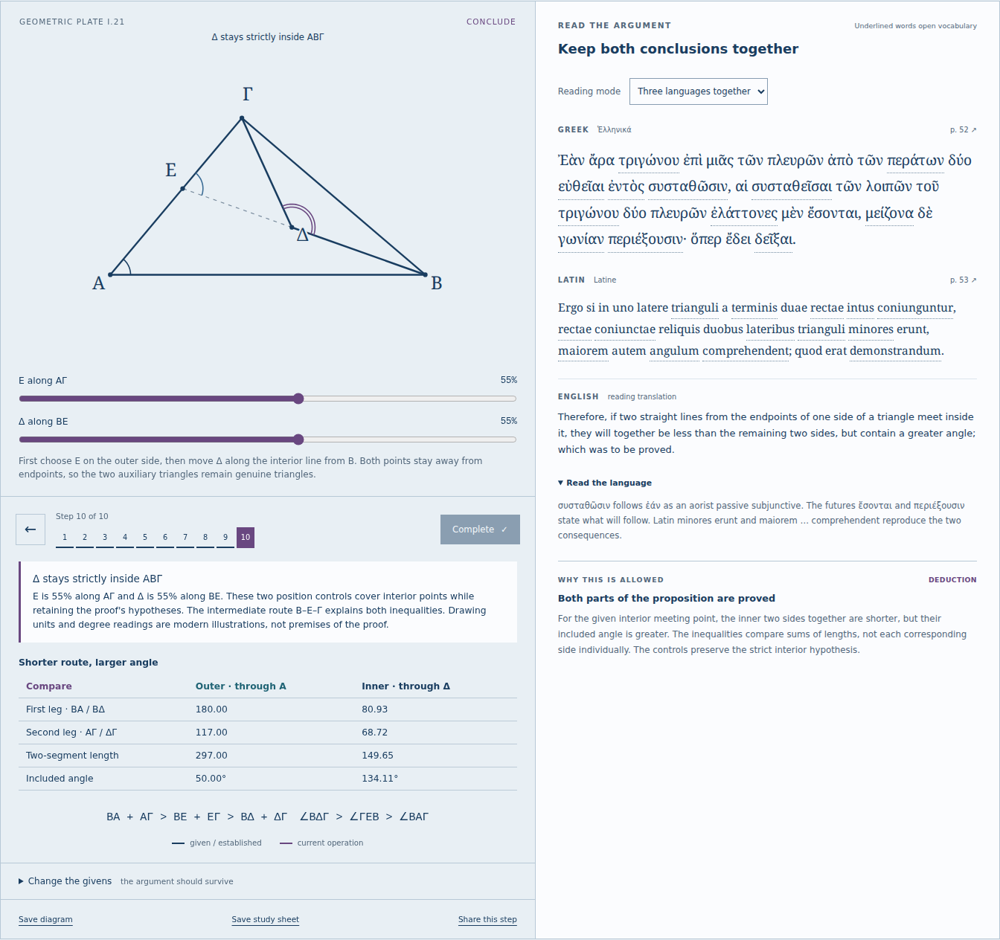

# The shorter route contains the larger angle

## What can be learned

[Euclid I.21](https://antonsoo.github.io/stoicheia/#p=21&s=9&m=55) now completes
the sequential course before the separate I.22 construction workshop. Move Ε
along ΑΓ, then Δ along ΒΕ. Δ stays strictly inside the triangle. The two inner
segments have a smaller combined length and a larger included angle.

The proof needs both comparisons. I.20 applied in ΑΒΕ and ΓΕΔ gives
`ΒΑ + ΑΓ > ΒΕ + ΕΓ > ΒΔ + ΔΓ`. I.16 applied in ΓΔΕ and ΑΒΕ gives
`∠ΒΔΓ > ∠ΓΕΒ > ∠ΒΑΓ`. The intermediate route Β–Ε–Γ connects them.
No later triangle-angle-sum theorem is used. Numbers illustrate the claims;
the source’s prior propositions justify them.

The individual-leg table also exposes a plausible misreading. At the default
outer triangle, move Δ to 11% along ΒΕ: ΔΓ exceeds ΑΓ, while the combined inner
route is still shorter. The proposition compares sums, not every side separately.
The two positive triangle-inequality excesses add to the total shortening.

## Source and model decisions

Ten aligned steps retain the complete Greek and Heiberg Latin on printed
pages 50–53, checked visually against the bundled scans. English translations,
language notes, drawings and step divisions are new. The course now has 174
steps, 51 vocabulary entries and 42 passage exercises. Two new exercises ask
about the contrast μέν … δέ and the interior placement `intus coniungantur`.

The English bracket **[on ΑΓ]** identifies the intersection implied by the
figure; it is not inserted into the Greek. The postulate-2 note identifies the
point-order and intersection assumptions. The common-notion reference in the
Latin uses Heiberg’s expanded numbering, not the usual coincidence principle.
[Transcription notes](sources.md#interior-comparison-i21).

The coordinate model puts Ε at fraction `u` of ΑΓ and Δ at fraction `v` of ΒΕ.
Δ’s barycentric weights in `(Α,Β,Γ)` are `(v(1-u), 1-v, vu)`. Each is positive
for the available 10–90% controls. The pure function rejects boundary and
degenerate inputs; shared-state decoding keeps browser inputs inside the range.
The frame remains fixed while moving through the proof, and both display axes
have the same scale. The exact selected points need not match the printed drawing.

## Verification

`npm run verify:nested` compares 648 combinations of shape, scale, orientation
and interior point with an independent Python implementation using barycentric
coordinates and cosine-law angles. All 12,960 comparisons passed; maximum
absolute discrepancy was 6.88e-12 against tolerance 1e-8. These quantities include
both lengths and degrees. [Oracle receipt](nested-review/oracle.json).

`npm run test:nested -- http://127.0.0.1:4405/stoicheia/` exercised Chromium
153.0.8010.12 and Firefox 155.0 at 1440 and 375 pixels. Each reviewed all ten
readings and 162 drawn cases by inspecting actual SVG coordinates and displayed
measurements. The journey includes the longer-individual-leg example, native
keyboard controls, vocabulary focus return, both reading exercises, shared-state
reload, source images 50–53, actual SVG/HTML downloads and offline use.
[Browser receipt](nested-review/browser.json).

The complete course was also replayed in both engines and both widths from a
clean archive: all 174 proof steps, all 42 practice exercises, page navigation
through 53 and the earlier constructions. The origin was disconnected below
the browser while testing offline reload. See [Chromium](nested-review/course-chromium.json)
and [Firefox](nested-review/course-firefox.json). These tests reported no page
errors or automated WCAG A/AA violations; they do not establish full accessibility
conformance. The [proof build inventory](nested-review/build.json) records the
66 files, 16,692,924 bytes, reproduced by a clean Node 24.21.0 install and build.

The saved study contains every complete Greek, Latin, English, language-note and
reason paragraph. Poppler content-stream extraction checks all 50 fields; raw
order is necessary because layout extraction interleaves the three columns.
The six-page proof-only PDF was visually inspected. [Print receipt](nested-review/print.json).
The [illustrated-export review](illustrated-review.md) adds the font and facsimiles
to the same proof. The linked examples are the final illustrated downloads.

These are numerical and browser checks of a teaching implementation, not formal
verification of Euclid’s axioms or a philologically complete critical edition.

## Publication

The final illustrated-study runtime was published as Pages commit `eef56bf`.
All 66 canonical public files match runtime `09234be`; Chromium and Firefox at
1440 and 375 pixels followed the I.21 controls, viewed page 53, saved and opened
the illustrated studies, and used the lesson offline. See the
[hosted receipt](illustrated-review/hosted.json) and
[illustrated-study review](illustrated-review.md) for the final export behavior.
