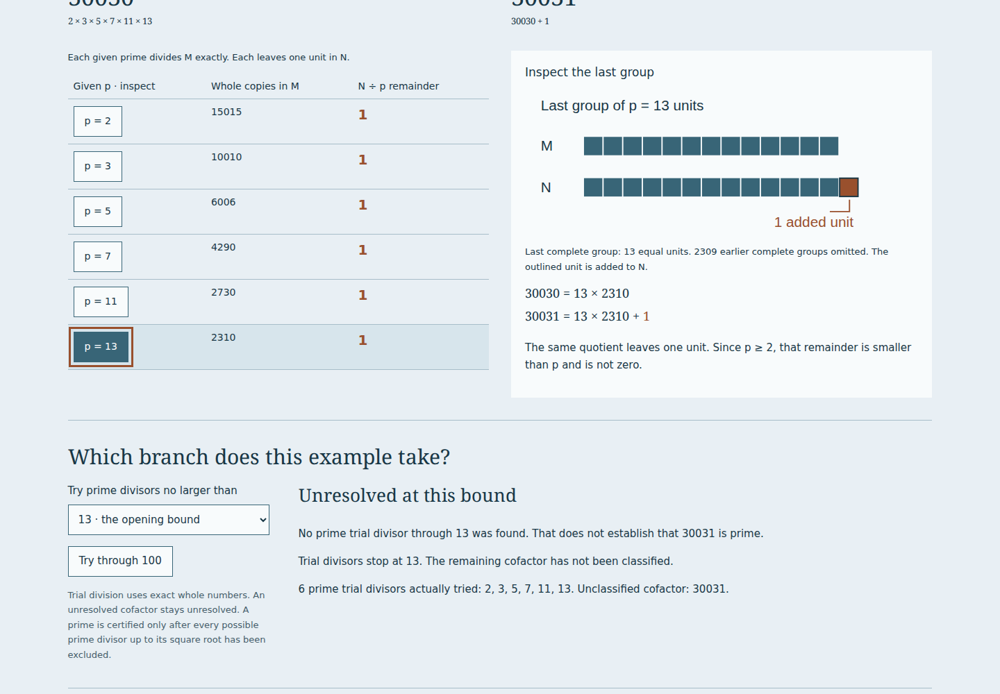

# Direct review of Euclid's extra prime

Reviewed 2026-10-27 in Los Angeles (2026-10-28 UTC). Source pages, exact
arithmetic, actual downloaded files, a clean build, browser behavior and public
delivery are distinct claims. This note records the local edition. A public
delivery review, when available, is a separate receipt.

## Try the actual work

1. Open `primes.html#pr-bench`, or choose **Euclid's extra prime** in the course's
   companion workshops. The givens are 2, 3, 5, 7, 11, 13. The constructed sum
   is 30031. The opening search through 13 says **unresolved**.
2. Inspect each ledger row. Every given prime divides 30030 and leaves exactly
   one unit in 30031. Select p = 13: the last group contains thirteen equal
   unit marks; the outlined added unit is separate. The 2309 earlier complete
   groups are explicitly omitted. Text and exact equations accompany the marks.
3. Use **Try through 100**. The result becomes **30031 = 59 × 509**. The sum is
   composite, yet 59 is a prime outside the given list. Read the active composite
   branch. Optionally add 59 to the givens and inspect a new construction.
4. Choose **Three givens**: 2, 3, 5 produce the prime sum 31. Then choose
   **An omitted smaller prime**: 3, 5, 7 produce 106 = 2 × 53. The additional
   prime can be smaller than every given. Neither branch promises the next prime.
5. Descend separately from 2310 through 1155, 385, 77 and 11, or choose other
   proper divisors. Every step remains a divisor of the start. Try to avoid
   reaching a prime, then read the VII.31 impossibility clause. Its general
   existence argument does not depend on this app's trial bound.
6. Read all eleven units. IX.20 is complete across the first seven; the
   definitions and selected VII.31 clauses support its use of unit and number.
   Read `πλείους / plures`, `μετρεῖται / metitur` and `ἀριθμὸς ὤν` in context.
   Check the whole printed page, including the p.389 endpoint discrepancy.
7. Save and reopen JSON. Make a share link and open it separately. Save the
   division CSV, exact SVG and illustrated HTML. Reopen the HTML from disk with
   scripting disabled; its native files and eleven complete source images remain.



[Phone ledger and unit diagram](assets/primes-mobile.png) ·
[Parallel Greek/Latin/English reading](assets/primes-reading.png).

## Direct evidence

| Claim                       | Observed evidence                                                                                                                                                                                                                          |
| --------------------------- | ------------------------------------------------------------------------------------------------------------------------------------------------------------------------------------------------------------------------------------------ |
| Source edition              | Fresh original PDF download; 25,785,657 bytes and pinned SHA-256; title MDCCCLXXXIV inspected; all eleven complete source images visually inspected and independently regenerated byte for byte                                            |
| Exact arithmetic            | Independent Python/sieve oracle verifies 456 cases: 424 list/bound cases and 32 direct-number cases; 10 proven prime, 400 proven composite, 46 unresolved; largest construction 120 decimal digits                                         |
| Clean build                 | Fresh local clone at `83bc4e2`; Node 24.21.0, `npm ci`, lint, strict typecheck, all 102 tests, production build and independent prime oracle pass                                                                                          |
| Build identity              | Clean and workspace builds match for all 213 canonical files; production inputs exclude later documentation and examples                                                                                                                   |
| Real operations             | Chromium and Firefox at 1440/375 px: root discovery, keyboard controls, all examples, exact remainders, new-prime addition, divisor descent, all readings, share reopening and actual native downloads                                     |
| Large inputs                | A twelve-prime 120-digit construction operates and wraps at both widths; primes too large for individual marks get an exact textual explanation                                                                                            |
| Source identities           | The actual displayed blobs of all eleven pages match the retained SHA-256 identities, separately from their captions                                                                                                                       |
| Import boundaries           | Unit 1 and malformed records are refused without replacing the current experiment; exact settings, full prime strings and the descent reopen successfully                                                                                  |
| Offline edition             | Current controller plus complete 212-file cache inventory; all thirteen rooms reload with browser networking disabled and the local origin stopped; source reading and export work offline                                                 |
| Native reading              | All four actual HTML downloads contain eleven byte-identical source images, the exact bundled font, complete MIT/OFL notices and four byte-identical native downloads; reopen from disk with scripts disabled and no remote asset requests |
| Printed reading             | Actual 26-page Chromium PDF retains all 44 Greek/Latin/English/note paragraphs and all eleven source JPEGs byte-identically; text stays inside checked margins; PDF reports tagged, without claiming a complete accessibility audit        |
| Source fault                | A different valid JPEG returned with HTTP 200 is refused in both viewer and illustrated export; retry with the correct page succeeds                                                                                                       |
| Late responses              | Held earlier source cannot replace the chosen title page; a held export keeps the settings at its original click while the current list and selected page change                                                                           |
| Accessibility/errors        | Zero axe violations under the checked WCAG 2 A/AA and 2.1 A/AA tags; no application errors or external requests in the four complete room journeys                                                                                         |
| Public delivery / remote CI | Not established by this local review; separate publication evidence is required                                                                                                                                                            |

The local edition is
`78ca62cdbb2f89a9684c1a7b84a97ef6aa9cea5871d08085d1f442371d2216ae`.
The independent oracle does not import the TypeScript implementation. It uses
Python arbitrary integers, an Eratosthenes sieve, factor-product reconstruction
and separate primality/divisibility checks. It does not assert that every
unresolved cofactor is composite.

[Source, mathematical boundaries and reproduction](primes-model.md) ·
[Machine-readable receipts](evidence/primes/) ·
[Actual retained examples](../examples/primes/).

## Reproduce

```sh
npm ci
npm run check
npm run verify:primes
npm run test:primes -- /tmp/stoicheia-primes-review
npm run verify:primes-files -- /tmp/stoicheia-primes-review
```

The browser helper serves the production `dist/` itself on an ephemeral local
port. It requires installed Playwright Chromium/Firefox; source and PDF checks
use Python 3 and Poppler. `npm run build` writes **`dist/`**. Original-page
reproduction requires the PDF identified in [the source note](primes-model.md).

## Limits

The theorem concerns any finite list; input is limited to twelve distinct primes
at most 10,000,000,000 and trial search to 100,000. The unresolved computational
state is not a third mathematical case. The descent controls are a separate
small illustration, not a fast general-purpose factoring method. Numerical
examples do not replace the universal divisibility argument.

New English and language notes have not had independent philological review.
No physical printer, manuscript reconstruction, formal proof assistant or
comprehensive assistive-technology/PDF accessibility review is claimed. SVG
uses the viewer's installed sans-serif font; the retained HTML embeds Noto Serif.
The source's textual quantities and its printed diagram are kept distinct.
