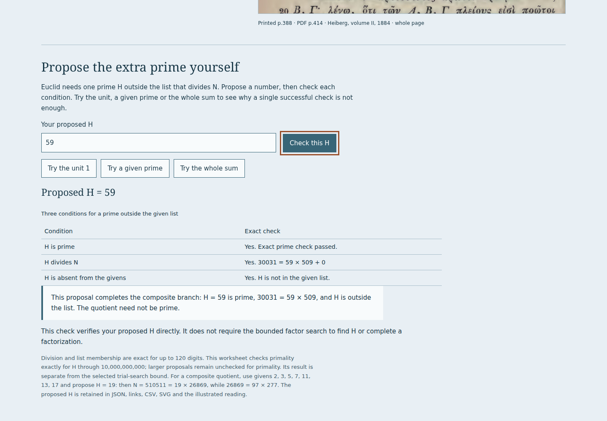

# Propose Euclid's extra prime

Reviewed locally on 2026-10-27 Los Angeles / 2026-10-28 UTC. This extends the
[first published IX.20 room](primes-publication.md) with an editable proof
witness. The source readings and eleven whole printed pages are unchanged.

## Try the actual work

1. Open `primes.html#pr-propose` with the six opening givens. Leave the factor
   search at 13. Try the unit: it divides N but is not prime. Try a given prime:
   it is prime but fails divisibility and absence. Try the whole sum: it divides
   N and is absent, but 30031 is composite.
2. Propose **H = 59**. All three conditions hold, so the composite branch is
   established. The factor-search panel still correctly says unresolved at its
   chosen bound. Verifying a proposed divisor is separate from finding it.
3. Use givens 2, 3, 5, 7, 11, 13, 17, then propose **19**. The exact quotient
   is 26869 = 97 × 277. That quotient can stay composite: the argument needs
   one prime H, rather than a complete factorization of N = 510511.
4. With 2, 3, 5, propose 31 to take the prime branch. Change the givens while
   keeping H; every condition re-evaluates against the new N.
5. Propose a number above 10,000,000,000. Divisibility and absence remain exact;
   primality is explicitly unchecked. Two successful checks do not certify H.
6. Save JSON/CSV/SVG/illustrated HTML and make a share link. H remains a decimal
   string, survives reopening and is distinguished from automatically found
   factors. The reading's native downloads retain the same work.
7. Reopen [the actual first version 1 file](../examples/primes/experiment-v1.json).
   All original settings remain, with no H invented for that old experiment.
   Propose H, save version 2 and reopen it offline.



[Phone worksheet](assets/primes-witness-mobile.png) ·
[27-page actual reading](../examples/primes/reading.pdf) ·
[Script-free reading, gzip](../examples/primes/reading.html.gz).

## Evidence

| Claim                | Direct observation                                                                                                                                                                                                                                    |
| -------------------- | ----------------------------------------------------------------------------------------------------------------------------------------------------------------------------------------------------------------------------------------------------- |
| Exact witness checks | Independent Python oracle checks 745 proposals: 3 prime-branch witnesses, 3 composite-branch witnesses, 584 rejected proposals and 155 with primality unchecked; alongside 460 construction/search cases, 1205 total                                  |
| Bounds               | Up to 120 exact decimal digits for H, product, quotient and remainder; exact primality through 10,000,000,000; larger H remains unchecked even if it divides N and is absent                                                                          |
| Build                | Clean checkout at `914f864`, Node 24, lint/strict typecheck/all 105 tests and production build; 213 canonical files and 212 offline files                                                                                                             |
| Browser matrix       | Chromium/Firefox at 1440/375 px: rejected and valid proposals, unfinished factorization, larger unchecked H, original file/link reopening, all source blobs, actual native downloads and thirteen offline rooms                                       |
| Native work          | Every actual JSON/CSV/SVG/HTML download retains H = 59; native files in script-disabled readings are byte-identical; CSV witness checks independently reconstructed                                                                                   |
| PDF                  | Actual 27-page output retains the witness and all three conditions, all 44 source-reading paragraphs and eleven source JPEGs byte-identically; checked text remains within margins                                                                    |
| Edition transition   | Four old-to-new browser journeys: the previously published complete edition controls first; the new current edition becomes complete; its old version 1 download reopens and becomes editable version 2 work; H survives offline reopening and export |
| Cache deletion       | Before the fix, reading one source after explicit cache deletion recreated the edition key. The new worker uses read-only lookup. All four upgraded browser contexts read the source successfully without recreating any deleted edition cache        |
| Late work            | Held source responses respect the latest page; held export retains its original H = 59 while the learner changes the current list, H to 2, and selected source page                                                                                   |
| Errors/accessibility | No page errors/external requests or checked axe violations in the four complete room journeys; no horizontal document overflow, including 120-digit proposals                                                                                         |

The reviewed production edition is
`8929a5829779439022444692ec6e3cc4ed52d8120ff03fdb54874a0d5d3c1136`.
The current MIT/author notices use Anthony Mercer, following the house identity.
Historical first-edition artifacts remain pinned to their earlier source.

[Local receipts](evidence/primes-witness/) distinguish the fresh current-edition
matrix, actual artifacts and old-to-new upgrade. Cache inspection in the upgrade
helper uses read-only global matching; it must not create caches merely to inspect
them. In the observed transition, Chromium retained the previous edition cache,
while Firefox retired it. The new matching complete cache controlled both;
blanket immediate removal of every legacy cache is not claimed. The explicit
deletion regression concerns reads by the **new** worker, whose lookup no longer
creates a cache. Older already-published worker code cannot be retroactively changed.

## Reproduce

```sh
npm run check
npm run verify:primes
npm run test:primes -- /tmp/stoicheia-witness-review
npm run verify:primes-files -- /tmp/stoicheia-witness-review
node scripts/primes-upgrade.mjs /path/to/previous/dist dist /tmp/stoicheia-witness-upgrade
python3 scripts/primes-artifacts.py /tmp/stoicheia-witness-upgrade --upgrade
```

The previous build is the first published edition above, built from production
inputs at `83bc4e2`. Preserve it before building current `dist/`. The upgrade
helper serves old and new builds on the same origin, preserves older hashed
assets, then stops the local origin and browser networking for offline work.
It does not substitute a precomputed conclusion for the learner's proposal.

Public delivery is a separate claim; this local note does not establish hosted
bytes, public browser behavior or remote CI. Primality bounds are computational
limits, not bounds on IX.20. No independent philological review, formal proof
assistant, physical printer or comprehensive PDF accessibility review is claimed.
