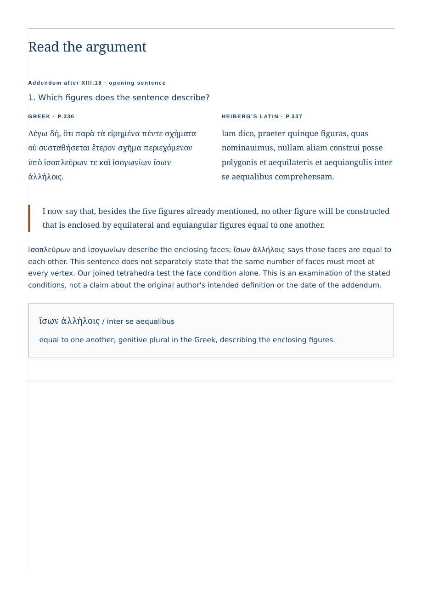

# A structured reading that keeps its evidence

The current [retained PDF](../examples/solids-reading.pdf) has 30 pages.
Headings have nested bookmarks; the main Greek and Latin paragraphs retain
language tags, with English inherited from the document. Numeric and letter
mapping tables retain explicit row/column header scopes. Diagrams and whole
historical page images retain descriptions.

This improves navigation and makes the selected transcriptions available as
structured text. It is a bounded content and structure review, not PDF/UA
certification or a claim about screen-reader playback. The full historical
pages remain facsimiles; only the selected passages are transcribed. Inline
language changes in vocabulary notes can depend on the producer and reader.
Physical printing is unverified.

## What the actual file contains

| Inspected property                                        | Actual result |
| --------------------------------------------------------- | ------------: |
| Main Greek/Latin/English paragraphs, in order             |            27 |
| Table headers with matching text and scopes               |            15 |
| Described leaf figures                                    |            18 |
| Original JPEGs bound to their own descriptions            |            15 |
| Heading bookmarks, with matching levels and heading pages |            19 |
| Complete license texts retained in print                  |             2 |

[Content bindings and hashes](solids-pdf-structure.json) ·
[Native files, printed text and image bytes](solids-pdf-artifacts.json) ·
[Four local browser journeys](solids-pdf-browser.json) ·
[Deliberate fault refusals](solids-pdf-faults.json).

The inspector reads the logical structure tree and its reverse ParentTree.
It follows each paragraph's marked-content identifiers into actual page content,
then extracts only the text bound to those identifiers. Re-serialization keeps
original glyph-code bytes, so subset-font character codes are not mistaken for
ordinary PDF strings. Complete text, language inheritance and reading order must
all agree with the saved HTML. A global text search or a `Tagged: yes` flag is
insufficient.

Each source image's compressed JPEG bytes must match the image embedded in the
HTML **under that figure's own description**. Each header's actual text and
row/column scope must agree with HTML. Each heading's bookmark must have the
same text and hierarchy and point to a page containing that heading's marked
content. The check does not certify every PDF structure rule or the exact scroll
position chosen by every reader.

## What changed after the first PDF

The earlier published capture had selectable text but no logical tags or
bookmarks. The browser export now explicitly requests both. Short tables stay
together in print: an actual two-page split had put a repeated header into one
header tag twice. A non-breaking space before the title's deliberate line break
keeps words separate in bookmark titles, where ordinary collapsible whitespace
was discarded by this Chromium build.



[Actual rendered table page](assets/solids-pdf-table.png). These are Poppler
renders of the retained PDF, not a browser mockup.

## Repeat the review

First produce real browser downloads with the workshop's existing driver:

```sh
npm ci
npm run build
npm run preview -- --port 4365
# In another terminal, from the same repository:
node scripts/solids-browser.mjs http://127.0.0.1:4365/stoicheia/ /tmp/solids-reading
python3 scripts/solids-artifacts.py /tmp/solids-reading
uv run --python 3.12 scripts/reading-pdf.py /tmp/solids-reading/chromium-1440/reading.pdf /tmp/solids-reading/chromium-1440/study.html /tmp/solids-structure.json
uv run --python 3.12 scripts/reading-pdf-faults.py /tmp/solids-reading/chromium-1440/reading.pdf /tmp/solids-reading/chromium-1440/study.html /tmp/solids-faults.json
```

The browser driver uses the installed Playwright browsers; the native-file check
needs Poppler. The two structure scripts declare their own pinned `pypdf 6.18.0`
dependency for `uv`; no Python dependency is added to the app. To inspect the
retained example instead, decompress `examples/solids-reading.html.gz` and pass
that HTML and `examples/solids-reading.pdf` to the inspector.

The fault driver first requires the unmodified PDF to pass. It then changes
copies while retaining the document's marked flag: swaps Greek and Latin tags,
swaps actual source-image objects, removes a table scope, removes a figure
description, sends a bookmark to the wrong page, and removes the structure tree.
All six are rejected for the intended content/structure reason. Inputs are never
changed. The PDF writer can warn that cloning created more objects than the
original trailer's size; this concerns the temporary cloned copies, not the
read-only inspection of the retained original.

The four browser configurations are Chromium and Firefox at 1440 and 375 px.
They operate controls, read the sources, reopen native files, run saved HTML
with scripts disabled and reload the complete edition offline. PDF production
in this record is Chromium only; Firefox operation is a separate claim.

## References and limits

The [W3C PDF reading-order technique](https://www.w3.org/WAI/WCAG22/Techniques/pdf/PDF3.html)
explains why tag order and meaningful structure matter. The PDF Association's
[Tagged PDF syntax guidance](https://pdfa.org/resource/tagged-pdf-best-practice-guide-syntax/)
distinguishes structure, language inheritance and figure descriptions. The
[parser documentation](https://pypdf.readthedocs.io/en/latest/modules/PdfReader.html)
describes the API used for inspection.

No screen-reader session, physical print, independent language review or PDF/UA
validator run is included. A described source-page image does not supply a full
transcription of that page. The script-free HTML is retained alongside the PDF
for readers who prefer native browser language and document semantics.
