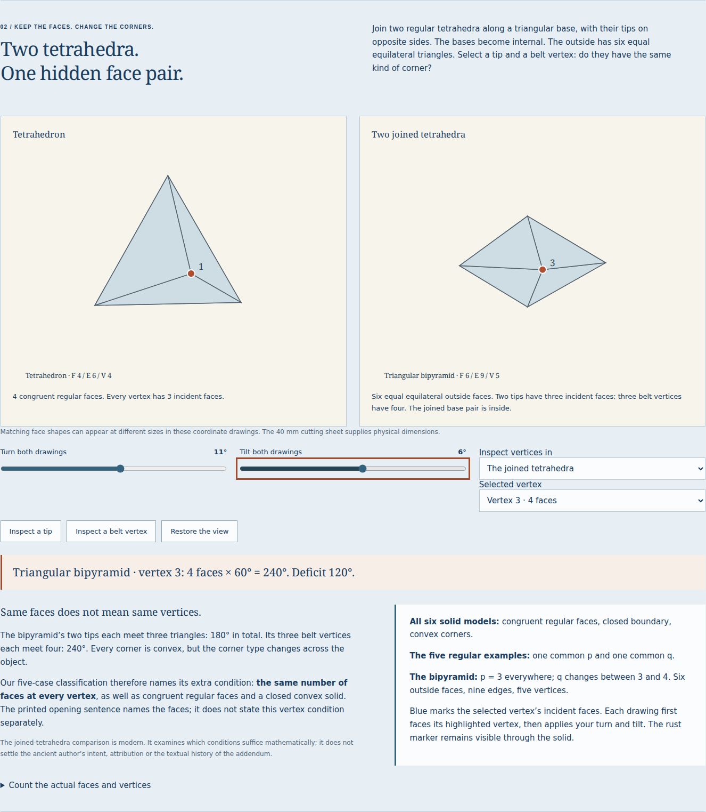
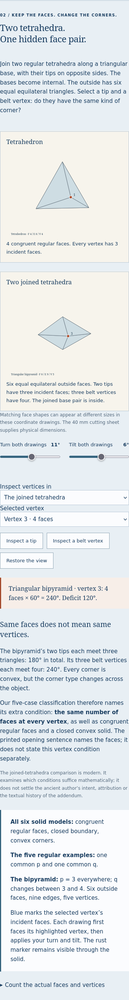

# Public solid-corner workshop

This records the initial public capture. The later [structured PDF review](solids-pdf-review.md)
updates the retained reading and print behavior; the older receipts below remain
evidence of their original edition.

The [canonical workshop](https://antonsoo.github.io/stoicheia/solids.html)
and [Officina's Latin source-word route](https://antonsoo.github.io/officina/?q=aequiangulis)
are public. This review was performed on 27 October 2026, separately from the
earlier [local review](solids-review.md).

| Surface                  | Observed result                                                                                                                               |
| ------------------------ | --------------------------------------------------------------------------------------------------------------------------------------------- |
| Published runtime source | `eb250643ff0d05c5d64a04eccbcc800995b84bf4`                                                                                                    |
| Pages branch             | `54461c319f7938a95bd2c43797c79bbbc403a597`                                                                                                    |
| Current edition          | `368495cc4ccda82777084224795c32f5657df21f60480bd7aae52e7cbb84da11`                                                                            |
| Clean Node 24 build      | All 198 files match the Node 26 reviewed build byte for byte; five retained native artifacts match the clean checkout                         |
| Canonical delivery       | All 198 current build files and both directory-entry checks match without cache-busting queries                                               |
| Actual public operation  | Chromium/Firefox, 1440 px/375 px; four complete journeys                                                                                      |
| Source viewing           | Fifteen canonical source identities and displayed pixel identities checked per journey                                                        |
| Native files             | JSON, exact CSV, calibrated SVG and illustrated HTML; script-disabled native reopening/downloads                                              |
| Actual public PDF        | 30 pages; all 27 Greek/Latin/English fields, fifteen original JPEG streams and both licenses retained; untagged, physical printing unverified |
| Offline                  | Matching controlling worker and all 197 precached files; disconnected reload, operation, saving and all twelve rooms                          |
| Public discovery         | Four continuous catalogue → lesson → native pinned-GitHub-heading journeys                                                                    |
| Source CI                | Run `40585812605`, failure; `check` job has no executed steps                                                                                 |
| Source Pages workflow    | Run `40585812641`, failure; `deploy` job has no executed steps                                                                                |
| Actual Pages service     | Run `40585948399`, success; build reported `built` for the Pages commit above                                                                 |

The owner explicitly authorized source and Pages pushes. Both Pages updates
preserve branch history with ordinary fast-forward commits. No registry release
or tag is implied. CI and the actual branch-based Pages publication are separate
results.

The first published twelve-room build was followed by two wording clarifications:
the convexity statement names all six solid models independently of a currently
rejected fan, and the live comparison distinguishes its coordinate drawings
from the physically dimensioned cutting sheet. The current public review and
complete file inventory include those clarifications. The earlier local
receipts retain their actual earlier edition identities.

[Canonical bytes](solids-hosted-files.json) ·
[complete public browser/cache journeys](solids-hosted-browser.json) ·
[actual public artifact audit](solids-hosted-artifacts.json) ·
[independent clean build](solids-clean-build.json).





The actual screenshots were inspected. Drawings show three incident tetrahedron
faces and four at the selected bipyramid belt vertex. Labelled measurements
remain readable without relying on the drawing's depth or colour. Narrow
numeric tables scroll inside their labelled regions. Source text and apparatus
remain available in the verified zoomable whole pages.

Replay against the public edition:

```sh
npm run test:solids -- https://antonsoo.github.io/stoicheia/ /tmp/solids-public
npm run verify:solids-files -- /tmp/solids-public
node ../pyknon/scripts/rhythm-publication.mjs https://antonsoo.github.io/stoicheia/ eb250643ff0d05c5d64a04eccbcc800995b84bf4 54461c319f7938a95bd2c43797c79bbbc403a597 /tmp/solids-files.json
```

The inventory helper requires the matching current `dist/` and a sibling
Pyknon checkout. Browser controls, public delivery, source-byte identity,
script-free artifacts and PWA readiness are independently recorded. Physical
assembly, physical printing, a full accessibility certification, independent
philological review and global-uniqueness proof checking are outside this review.
