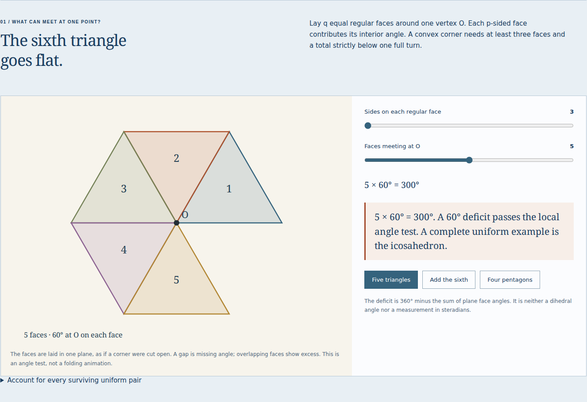
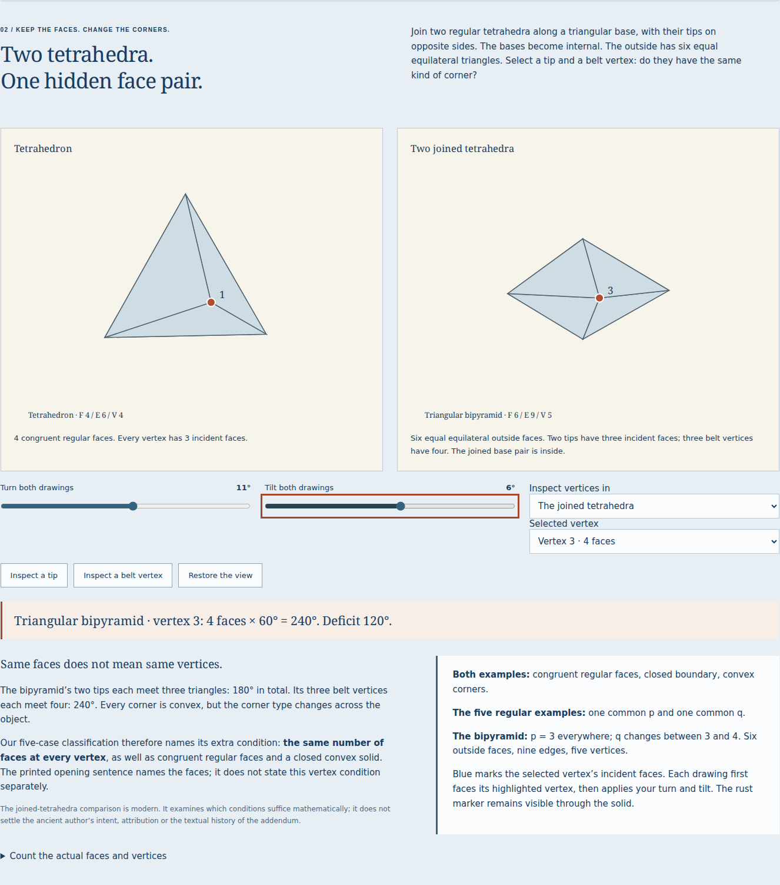

# Direct review of the solid-corner workshop

[Subsequent public verification](solids-publication.md) records canonical bytes,
actual public operation, portable files and offline use separately from this
local review.

`solids.html` lets an English-speaking learner test the addendum after Euclid
XIII.18, then inspect a convex six-faced comparison. Equal equilateral outside
faces alone do not require one common vertex type. The triangular bipyramid's
two tips and three belt vertices supply a concrete way to see the missing
condition without attributing a new meaning or historical error to the text.

## Try the actual work

```sh
npm ci
npm run dev
```

Open `http://127.0.0.1:4327/stoicheia/`. Under **Explore companion workshops**,
choose **Six faces. Still not one of five.** The direct route is
`/stoicheia/solids.html`.
1. Start with five equilateral triangles. Add the sixth: 360° uses the complete
   turn, so the corner lies flat. Move the q slider Home: two faces are a hinge,
   even though their sum is less than 360°.
2. Choose four pentagons: 432° exceeds a full turn. Press the q slider's left
   arrow once: three pentagons leave 36°, with a dodecahedron as a complete
   example. Six sides at three faces lies flat again.
3. Open the uniform-pair table and inspect the five examples. The polygon and
   complete solid are actual coordinate drawings, with whole square and
   pentagonal faces. A local angle test is distinguished from constructing a
   complete solid or proving its uniqueness.
4. Select **Inspect a tip**, then **Inspect a belt vertex** on the joined
   tetrahedra. The same six-faced object has three-face and four-face corners.
   Turn and tilt the drawings. The selected vertex is first faced toward the
   viewer; its incident faces remain blue and its number remains labelled.
5. Open **Count the actual faces and vertices**. The conditional inference
   assumes every vertex matches the selected one. A tip predicts four vertices;
   a belt vertex predicts six. The actual bipyramid keeps five. Its actual
   deficits still sum to 720°. The modern Euler explanation is labelled.
6. Read the opening condition, the three/four/five triangle sentence, the
   sixth-triangle reason, and the definition of a solid corner. Inspect the
   Greek and Latin pages, including the fourth reading's Latin continuation.
   Enlarge a complete page and use arrow keys in its scrolling image region.
7. Save JSON, exact CSV, an A4 tetrahedron cutting sheet, and the illustrated
   reading. Change a setting and reopen the JSON. Copy an explicit experiment
   link and use Back/Forward. Invalid imports keep the current work.
8. Wait for **Edition ready offline**, disconnect, reload and inspect both
   corner types. Save another reading. Reopen the saved HTML with scripts
   disabled: its diagrams, all nine readings, fifteen sources, font and three
   native downloads remain available.

## What was actually checked

| Claim                        | Evidence and observed limit                                                                                                                                                          |
| ---------------------------- | ------------------------------------------------------------------------------------------------------------------------------------------------------------------------------------ |
| Exact local constraints      | 70 supported p/q cases; five surviving uniform pairs, with the general p ≥ 6 reason stated separately                                                                                |
| Complete coordinate geometry | Six meshes independently reconstructed from their shortest-edge graphs; face regularity, coplanarity, convex support and boundary incidences checked                                 |
| Conditional counts           | 55 vertex inferences cross-checked by solving the incidence equations and Euler's relation independently                                                                             |
| Primary-source identity      | Fifteen complete JPEGs reproduced byte for byte from the identified PDF                                                                                                              |
| Production browser work      | Four complete Chromium/Firefox journeys at 1440 px and 375 px; controls, source display pixels and bytes, history, downloads, offline and script-disabled reopening                  |
| Development                  | The same four learner workflows and saved-file audit on the actual Vite development server                                                                                           |
| Native artifacts             | Editable records, all 70 exact CSV rows and selected vertex incidences; identical native downloads from script-disabled readings                                                     |
| Paper geometry               | Actual saved SVG paths form two four-face nets with 40 mm edges and a 50 mm calibration bar; complete MIT license retained                                                           |
| Printed reading              | 30-page browser PDF, all 27 complete Greek/Latin/English fields, fifteen original JPEG streams retained byte for byte and both complete licenses; untagged and physically unprinted  |
| Failure handling             | Late source ignored; HTTP 200 source/font substitutions refused; export captures earlier settings; delayed file read preserves newer work                                            |
| Edition upgrade              | Actual eleven-room source `c4ceb91ed96d1eb5fbc5c9687f2b7b690d4bf677` to twelve rooms; both browsers, held/substituted new source, controller transition and origin-disabled recovery |
| Upgrade artifacts            | Four actual offline readings audited for original pages, font, licenses, exact CSV and cutting-sheet geometry                                                                        |
| Public delivery              | A separate review is required after publication; this record initially describes local work                                                                                          |

[Geometry](solids-geometry.json) · [source manifest](../public/sources/solids/manifest.json) ·
[production browser](solids-browser.json) · [native artifacts](solids-artifacts.json) ·
[development](solids-development.json) · [failure handling](solids-integrity.json) ·
[edition upgrade](solids-upgrade.json) · [upgrade files](solids-upgrade-artifacts.json).

The checked final page states had zero reported axe violations and no page
errors. That is a limited automated observation, not a complete accessibility
certification. Labelled numeric tables and controls provide alternatives to
the 3D view. Each saved reading has a matching font, full MIT/OFL licenses,
fifteen original page images, and no script or automatic remote subresource.

Two defects found during review were corrected before the retained final runs:
a source-image reuse/decode failure in Firefox and a six-pixel overflow in the
saved phone table. The final records do not describe the earlier failed runs.

## Retained work





[Phone corner](assets/solids-corner-chromium-375.png) ·
[Phone mixed vertices](assets/solids-comparison-firefox-375.png) ·
[Greek and Latin source pages](assets/solids-source-chromium-1440.png).

[Actual illustrated HTML, gzip](../examples/solids-reading.html.gz) ·
[Actual 30-page PDF](../examples/solids-reading.pdf) ·
[Editable record](../examples/solids-experiment.json) ·
[Exact CSV](../examples/solids-angles.csv) ·
[A4 paper experiment](../examples/solids-two-tetrahedra.svg).
Decompress the HTML before opening it.

## Reproduce the review

```sh
npm run check
npm run verify:solids
python3 scripts/solids-sources.py /path/to/euclidisoperaomn04eucl.pdf
npm run build
npm run preview
```

In another terminal, using the default preview port:

```sh
npm run test:solids -- http://127.0.0.1:4327/stoicheia/ /tmp/solids-review
npm run verify:solids-files -- /tmp/solids-review
node scripts/solids-integrity.mjs http://127.0.0.1:4327/stoicheia/ /tmp/solids-integrity
```

For development, set `SOLIDS_DEVELOPMENT=1` and supply the actual development
URL. The driver then records development behavior without making an offline
claim. For the authentic upgrade, build the identified prior source separately,
then run `node scripts/solids-upgrade.mjs /path/to/previous/dist /tmp/solids-upgrade.json`
and `python3 scripts/solids-artifacts.py /tmp/solids-upgrade.json --upgrade`.

Historical source claims, exact arithmetic, rounded coordinates, conditional
global counts, PWA readiness, local artifacts and public delivery are separate
claims. [Source, assumptions and limitations](solids-model.md).
